# TrueShow — Complete User Guide

Welcome to **TrueShow**, an open-source, cross-platform (**Windows, macOS, Linux**) worship and live-event presentation suite built on a native **Rust + `wgpu` GPU engine** with a fast, low-clutter desktop control surface.

This guide walks new operators through their first Sunday service and serves as a complete reference for **every workspace, menu item, drawer, button, right-click menu, drag-and-drop workflow, import format, broadcast output, and keyboard shortcut** included in TrueShow.

---

## Table of Contents

1. [How TrueShow Works (Architecture & Sunday-Morning Safety)](#1-how-trueshow-works-architecture--sunday-morning-safety)
2. [Getting Started & Interface Tour](#2-getting-started--interface-tour)
   - [Top Application Menu Bar](#21-top-application-menu-bar)
   - [Bottom Live Telemetry Status Bar](#22-bottom-live-telemetry-status-bar)
   - [Context-Aware Right-Click Menus & Cascading Submenus](#23-context-aware-right-click-menus--cascading-submenus)
3. [Running a Live Service (The Show Workspace)](#3-running-a-live-service-the-show-workspace)
   - [Cue Deck, Transitions, Fit Modes & Masks](#31-cue-deck-transitions-fit-modes--masks)
   - [Audio Playback Bar & Stage Message Quick-Send](#32-audio-playback-bar--stage-message-quick-send)
   - [Native GPU Monitors Pane](#33-native-gpu-monitors-pane)
   - [Freeze Output, Undo/Redo, Clear All & Blackout](#34-freeze-output-undoredo-clear-all--blackout)
4. [Libraries, Presentations & Playlists](#4-libraries-presentations--playlists)
5. [The 7-Layer GPU Compositor & Media Bins (Background vs. Foreground)](#5-the-7-layer-gpu-compositor--media-bins-background-vs-foreground)
6. [Song Arrangements (Drag-and-Drop Editor) & Auto-Play / Live Cue Recorder](#6-song-arrangements-drag-and-drop-editor--auto-play--live-cue-recorder)
   - [Creating & Reordering Song Arrangements](#61-creating--reordering-song-arrangements)
   - [Recording Live Cues & Running Auto-Play](#62-recording-live-cues--running-auto-play)
   - [Per-Slide Timers & Looping Slideshows](#63-per-slide-timers--looping-slideshows)
7. [Scripture Lookup & Dual-Translation Slides](#7-scripture-lookup--dual-translation-slides)
8. [Quick Lyrics & Bilingual Authoring](#8-quick-lyrics--bilingual-authoring)
9. [Overlays / Props, Audience Messages & Dynamic Variables](#9-overlays--props-audience-messages--dynamic-variables)
10. [WYSIWYG Slide Editor](#10-wysiwyg-slide-editor)
11. [Screens, Physical Monitor Splitting & Multi-Projector GPU Edge Blending](#11-screens-physical-monitor-splitting--multi-projector-gpu-edge-blending)
12. [Looks, Multi-Screen Look Routing & Slide Templates](#12-looks-multi-screen-look-routing--slide-templates)
13. [Visual Stage Confidence Display Designer](#13-visual-stage-confidence-display-designer)
14. [Broadcast Video I/O, Virtual Outputs & LAN Mobile Web Remote](#14-broadcast-video-io-virtual-outputs--lan-mobile-web-remote)
15. [Tools Suite: Live Timers, Macros, Calendar Schedule & OSC / Companion](#15-tools-suite-live-timers-macros-calendar-schedule--osc--companion)
16. [Importing Presentations, Lyric Sheet PDFs, PowerPoint, Keynote, Images & Planning Center](#16-importing-presentations-lyric-sheet-pdfs-powerpoint-keynote-images--planning-center)
    - [Choosing Target Libraries & Media Bins](#161-choosing-target-libraries--media-bins)
    - [Local Presentation & Lyrics Import (PDF, Images, PPTX, Keynote, FreeShow, ProPresenter)](#162-local-presentation--lyrics-import-pdf-images-pptx-keynote-freeshow-propresenter)
    - [Collision-Safe Local Media Import](#163-collision-safe-local-media-import)
    - [Planning Center Online (Services v2) Attachments Importer](#164-planning-center-online-services-v2-attachments-importer)
    - [Paste Worship Document Importer](#165-paste-worship-document-importer)
17. [Automated CCLI License & Song Attribution Display + CSV Audit Reports](#17-automated-ccli-license--song-attribution-display--csv-audit-reports)
18. [Portable Full-Library Backup & Restore (`.tsbundle`)](#18-portable-full-library-backup--restore-tsbundle)
19. [Diagnostics, Rolling Logs, Crash Reports & Recovery](#19-diagnostics-rolling-logs-crash-reports--recovery)
20. [Complete Keyboard Shortcuts Reference](#20-complete-keyboard-shortcuts-reference)

---

## 1. How TrueShow Works (Architecture & Sunday-Morning Safety)

TrueShow is intentionally engineered as **two cooperating processes**:

1. **`trueshow-engine` (Decoupled GPU Render Sidecar):**
   - Renders every physical Audience display, Stage Confidence display, and Broadcast feed directly on your graphics card (`DX12`, `Vulkan`, or `Metal` via `wgpu`).
   - **Never uses a web browser to draw your sanctuary screens.**
   - Streams real-time RGBA8 thumbnails back to the operator UI over lock-free shared memory.
2. **`trueshow-desktop` (Operator Control Surface):**
   - The lightweight operator window where you organize playlists, click slides, edit text, manage timers, and configure screens.

> **Why this matters on Sunday morning:** If you ever reload the operator UI (**File → Reload UI (Keep Live)**) — or even if the UI window closes unexpectedly — **your sanctuary screens stay completely live at 60 fps with zero blackout.** When the UI reopens, it seamlessly re-attaches to the running GPU engine.

- **100% Offline-First Storage:** All songs, arrangements, recorded cue tracks, playlists, Bible translations, looks, templates, macros, CCLI settings, and usage logs are stored locally in an indexed SQLite (WAL + FTS5) database. Internet access is only ever needed when you explicitly click **Fetch Plans** in the Planning Center importer.

---

## 2. Getting Started & Interface Tour

When you launch TrueShow, the app automatically connects to `trueshow-engine` and opens directly into the **Show Workspace**.

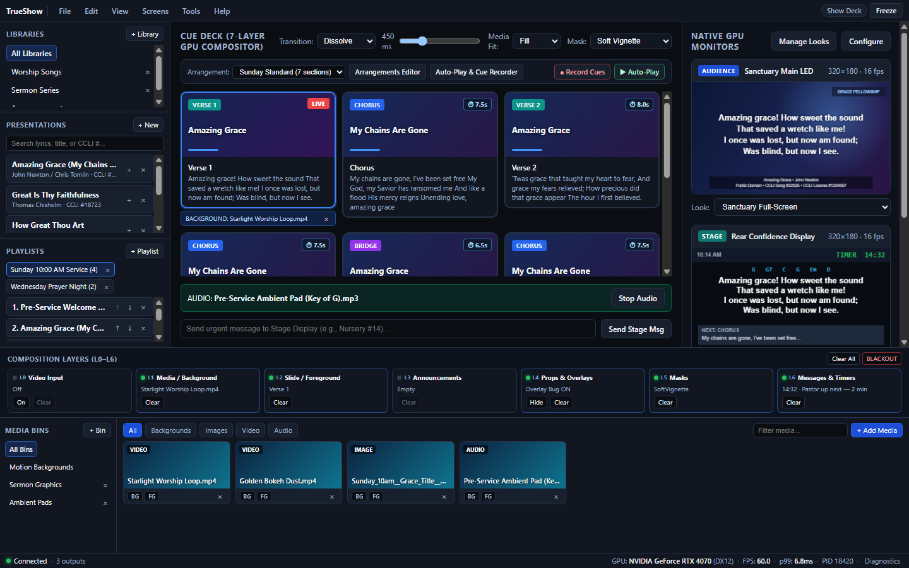

The Show Workspace is divided into six focused zones:

| Zone | Location | Purpose |
| :--- | :--- | :--- |
| **Application Menu Bar** | Top (`34px`) | Clean dropdown menus (`File`, `Edit`, `View`, `Screens`, `Tools`), active view indicator, quick `Show` return button, and `Freeze` toggle. |
| **Libraries & Playlists Drawer** | Left sidebar | Browse presentation libraries, instant full-text search, manage songs/presentations, and run service playlists. |
| **Main Workspace / Cue Deck** | Center | Displays the active presentation's slides (or whichever management view you opened from the Menu Bar). |
| **Native GPU Monitors** | Right sidebar | Live shared-memory previews of every configured Audience, Stage, and Broadcast output, with per-screen Look selectors. |
| **Composition Layers Dock (L0–L6)** | Lower middle | One-click visibility, status, and individual Clear controls for all 7 compositor layers, plus `Clear All` and `BLACKOUT`. |
| **Media Bins Drawer** | Bottom panel | Browse and trigger motion backgrounds, images, videos, and audio pads (`BG` or `FG`), or drag media onto slides and layers. |
| **Live Telemetry Status Bar** | Very bottom (`24px`) | Connection indicator, active output count, `BLACKOUT`/`FROZEN` badges, GPU name & API, live FPS, p99 frame time, Engine PID, and `Diagnostics` link. |

> **Tip — Maximize Your Screen Space:** You can collapse or re-open the **Libraries & Playlists Drawer**, **Layer Manager Dock**, or **Media Bin Drawer** at any time from the **View** menu so smaller laptops have plenty of room for slides or editing panels.

---

### 2.1 Top Application Menu Bar

Instead of crowding dozens of buttons across the top edge of the window, all navigation and engine controls live neatly inside five standard menus:

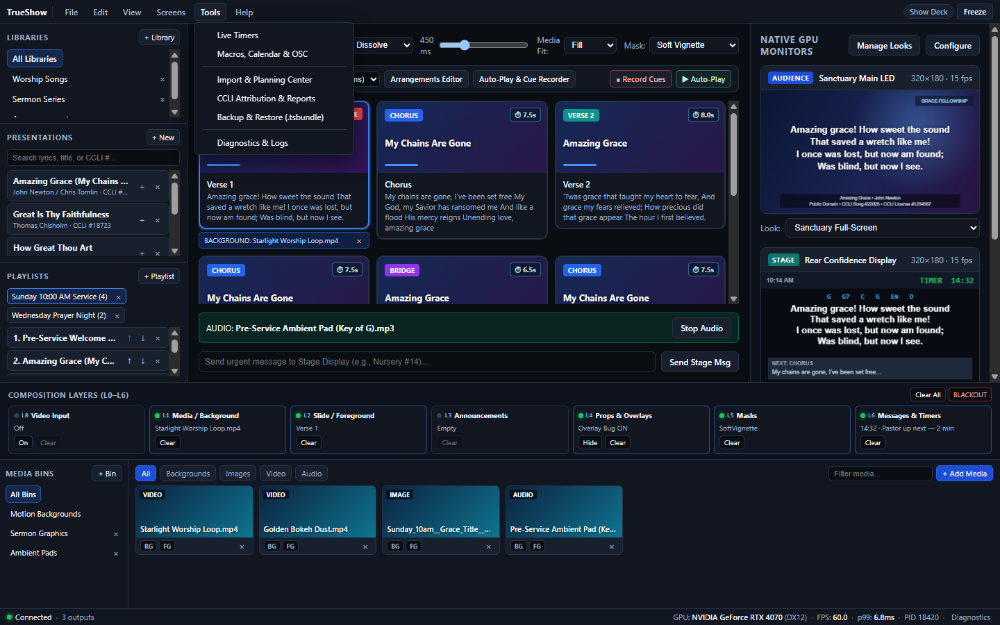

| Menu | Items & What They Do |
| :--- | :--- |
| **File** | **Show Deck**, **Scripture Lookup**, **Quick Lyrics & Arrangements**, **Import Files & Planning Center…**, **Backup & Restore (`.tsbundle`)…**, **Reconnect Engine**, **Reload UI (Keep Live)** (reloads the operator window without interrupting live outputs), **Stop Engine** (stops the sidecar render engine only), **Shutdown All** (gracefully closes both the UI and the GPU engine). |
| **Edit** | **Undo (`Ctrl+Z`)**, **Redo (`Ctrl+Y`)**, **Slide Editor**, **Overlays & Messages**. |
| **View** | Switch between **Show Workspace**, **Scripture Drawer**, **Quick Lyrics**, and check/uncheck **Libraries & Playlists Drawer**, **Layer Manager Dock**, and **Media Bin Drawer** to show or hide workspace panels. |
| **Screens** | **Configure Screens & Monitors**, **Looks & Templates**, **Stage Layout Designer**, **Broadcast I/O & LAN Remote**. |
| **Tools** | **Live Timers**, **Macros, Calendar & OSC**, **Import & Planning Center**, **CCLI Attribution & Reports**, **Backup & Restore (`.tsbundle`)**, and **Diagnostics & Logs** (displays a crash badge count if any issue was recorded). |
| **Help** | **User Guide** (opens this complete illustrated manual right inside TrueShow, 100% offline with search and click-to-zoom screenshots), **Keyboard Shortcuts** (jumps straight to Section 20), and **Diagnostics & Logs**. |

On the far right of the Menu Bar:
- **Active View Pill:** Shows which screen you are currently viewing (e.g., `Show Deck`, `Slide Editor`, `Import & Planning Center`).
- **`Show` Button:** Appears whenever you are on a secondary panel so you can jump straight back to your live Cue Deck in one click.
- **`Freeze` / `Unfreeze` Button (`F`):** Freezes all live outputs on their current frame so you can silently edit slides, switch songs, or reorganize playlists behind the scenes without the congregation seeing any movement.

---

### 2.2 Bottom Live Telemetry Status Bar

The slim `24px` footer keeps critical production health visible at a glance without taking away vertical slide space:

- **Left side:** Green pulsing dot + `Connected` (or an inline **Reconnect** button if the engine was stopped), total output count (`3 outputs`), and bright **`BLACKOUT`** or **`FROZEN`** warning badges whenever either safety state is active.
- **Right side:** Active GPU adapter & graphics backend (e.g., `GPU: NVIDIA GeForce RTX 4070 (DX12)`), live **FPS**, **p99 frame time** in milliseconds, Engine **PID**, and a one-click **`Diagnostics`** shortcut.

---

### 2.3 Context-Aware Right-Click Menus & Cascading Submenus

TrueShow replaces the default browser context menu with **context-aware operator menus** tailored to whatever item you right-click. *(Standard Copy/Paste/Cut right-click menus still work normally whenever you right-click inside a text box or search field.)*

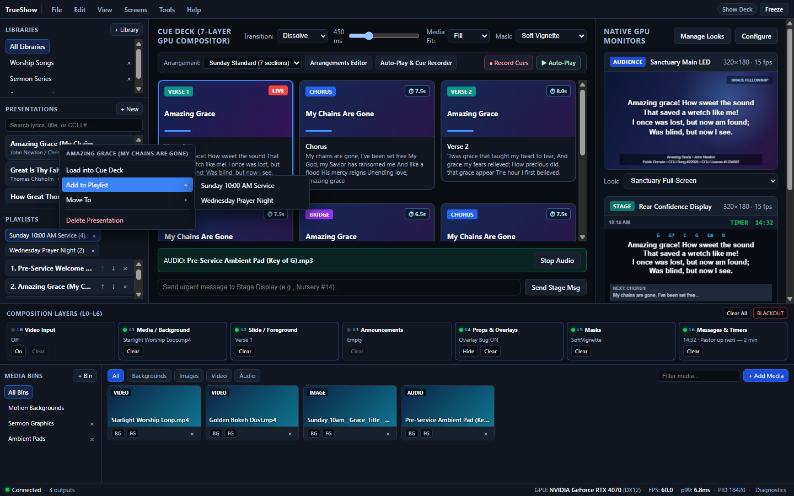

| Where You Right-Click | Available Context Menu Actions |
| :--- | :--- |
| **Slide Card (Cue Deck)** | **Go Live (Trigger Slide)**, **Edit in Slide Editor**, **Set Auto-Play Timer…**, **Clear Slide Layer (`F2`)**, **Remove Attached Cue** *(when a media cue is attached)*, **Blackout (`B`)**, **Clear All Layers (`F1`)**. |
| **Presentation (Libraries Drawer)** | **Load into Cue Deck**, **Add to Playlist ▸** *(cascading flyout submenu listing all playlists)*, **Move To ▸** *(cascading flyout submenu listing all libraries)*, **Delete Presentation**. |
| **Playlist Cue Item** | **Load into Cue Deck**, **Move Up**, **Move Down**, **Remove from Playlist**. |
| **Media Asset Card (Media Bin)** | **Trigger as Background (L1)**, **Trigger as Foreground (L2)**, **Move To ▸** *(cascading flyout submenu listing all Media Bins)*, **Remove Media Asset**. |
| **Live GPU Monitor Preview** | **Configure Screen & Monitors**, **Manage Looks & Templates**, **Stage Layout Designer** *(Stage outputs only)*, **Freeze Output (`F`)**, **Blackout (`B`)**, **Clear All Layers (`F1`)**. |
| **Composition Layer Chip (L0–L6)** | Layer-specific quick actions (e.g., **Enable/Disable Video Input**, **Show/Hide Overlays**, **Clear This Layer**, **Clear All Layers (`F1`)**, **Blackout (`B`)**). |

---

## 3. Running a Live Service (The Show Workspace)

### 3.1 Cue Deck, Transitions, Fit Modes & Masks

At the top of the **Cue Deck**, four real-time controls govern how slides and media appear when triggered:

1. **Transition:** Choose `Dissolve` (smooth crossfade), `Push Left`, `Wipe Right`, or `Cut` (instantaneous).
2. **Duration Slider (`100 ms – 1500 ms`):** Adjusts the speed of `Dissolve`, `Push Left`, and `Wipe Right` transitions.
3. **Media Fit:** Controls how images and videos fill non-matching aspect ratios on the GPU:
   - `Fill` — scales proportionally to fill the entire output (cropping overflow).
   - `Contain` — fits the entire image/video inside the frame (letterboxing if needed).
   - `Stretch` — stretches to match the exact output dimensions.
4. **Mask:** Applies a GPU shader mask on Layer 5 (`None`, `Soft Vignette`, `Rounded Frame`, or `Lower Third Band`).

**Triggering Slides:**
- Click any slide card in the Cue Deck (or press **`Space`**, **`ArrowRight`**, or **`PageDown`**) to send it live with your active transition.
- Each slide card shows:
  - A **color-coded section group badge** (`Verse` = teal, `Chorus` = blue, `Bridge` = purple, `Scripture` = amber).
  - A red **`LIVE`** pill on the slide currently on air.
  - A **`⏱ 8.0s`** (or **`↻`** loop) pill if an Auto-Play timer is set on that slide.
  - An attached media badge (e.g., `BACKGROUND: Starlight Worship Loop.mp4 ×`) if a media cue is bound to fire automatically when that slide triggers. Click `×` to detach it.

---

### 3.2 Audio Playback Bar & Stage Message Quick-Send

Directly beneath the slide grid in the Cue Deck:
- **Audio Bar (green banner):** Appears whenever an audio track (such as a pre-service ambient pad or walk-in music) is playing, showing the track title and a one-click **`Stop Audio`** button.
- **Stage Message Bar:** Type an urgent note for the worship team or speaker (e.g., `Pastor up next — 2 min` or `Mic 3 battery low`) and click **`Send Stage Msg`** (or press `Enter`). To clear the stage message, empty the text box and click **`Send Stage Msg`**, or clear Layer 6 (`Messages & Timers`).

---

### 3.3 Native GPU Monitors Pane

The right-hand **Native GPU Monitors** column displays live hardware-composited frames for every screen you have configured:
- **`AUDIENCE`** badge (blue) for sanctuary projectors, LED walls, and livestream lower-thirds (transparent alpha renders over a dark checkerboard so you can verify keying).
- **`STAGE`** badge (teal) for confidence monitors showing Current Slide, Chords, Next Slide, Countdown Timer, and Stage Message.
- **Per-Output `Look` Dropdown:** Immediately change the active Look assigned to that output right from the Show Workspace.
- **`Manage Looks`** and **`Configure`** header buttons jump straight to [Looks & Templates](#12-looks-multi-screen-look-routing--slide-templates) or [Configure Screens](#11-screens-physical-monitor-splitting--multi-projector-gpu-edge-blending).

---

### 3.4 Freeze Output, Undo/Redo, Clear All & Blackout

- **`Freeze` (`F`):** Holds the last rendered GPU frame on every live output while allowing you to click around the operator UI freely. Click **`Unfreeze`** (or press `F` again) to resume live rendering immediately.
- **Undo (`Ctrl+Z`) / Redo (`Ctrl+Y` or `Ctrl+Shift+Z`):** Reverts or re-applies recent live scene state changes.
- **`Clear All` (`F1`):** Clears unlocked visual layers (slides, backgrounds, announcements, non-locked overlays, messages). **Locked Overlays** (like a church bug or watermark) remain safely on screen!
- **`BLACKOUT` (`B`):** Instantly drops all live outputs to solid black (ideal for emergencies, baptism moments, or stage transitions). Press `B` or click `BLACKOUT` again to return smoothly to live output.

---

## 4. Libraries, Presentations & Playlists

The left-hand **Libraries & Playlists Drawer** organizes all of your church's songs, sermon decks, and weekly service orders in local SQLite storage:

1. **Libraries (`+ Library`):**
   - Click **`All Libraries`** to search across everything, or click a specific library (e.g., `Worship Songs`, `Sermon Series`, `Announcements`) to filter.
   - Click **`+ Library`** to create a new library folder, or click `×` on a custom library to remove it.
2. **Presentations (`+ New` & Instant Search):**
   - Type any title, lyric snippet, author name, or CCLI number into **`Search lyrics, title, or CCLI #...`** for instantaneous offline SQLite FTS5 search.
   - Click a presentation to **load it into the Cue Deck**.
   - Click **`+`** on a presentation to append it to the currently selected Playlist, or right-click for the full context menu (including cascading **`Add to Playlist ▸`** and **`Move To ▸`** submenus).
   - **Drag & Drop:** Drag any presentation directly onto a **Library** name to move it to that library, or drag it onto a **Playlist** tab to add it to that service order.
3. **Playlists (`+ Playlist`):**
   - Click **`+ Playlist`** to start a new service order (e.g., `Sunday 10:00 AM Service`).
   - Click any item inside the active playlist to load it straight into the Cue Deck.
   - Reorder cues using the **`↑` / `↓`** arrows, by **dragging and dropping** playlist items into a new order, or via right-click.

---

## 5. The 7-Layer GPU Compositor & Media Bins (Background vs. Foreground)

TrueShow renders every screen as a deterministic **7-layer GPU stack** from bottom (`L0`) to top (`L6`), visible in the **Composition Layers Dock**:

| Layer | Name | Persistence Behavior | Typical Use |
| :---: | :--- | :--- | :--- |
| **L0** | **Video Input** | Toggles on/off independently (`On`/`Off`, `Clear`) | Live camera feed / IMAG backdrop behind lyrics. |
| **L1** | **Media / Background** | **Persists** across slide changes until cleared or replaced! | Looping motion backgrounds, worship stills, subtle textures. |
| **L2** | **Slide / Foreground** | **Replaces/clears** automatically on each new slide trigger (`F2` clears) | Lyrics, Scripture, Sermon points, or Foreground full-screen videos/graphics. |
| **L3** | **Announcements** | Independent loop/layer | Pre-service announcement graphics or independent announcement deck. |
| **L4** | **Props & Overlays** | Multi-item stack (`Hide`/`Show`, `Clear`); **Locked** items survive `Clear All` | Church logo bug, livestream lower-third callouts, "Give Online" banners. |
| **L5** | **Masks** | GPU alpha/vignette shaping mask | `SoftVignette`, `RoundedFrame`, `LowerThirdBand`. |
| **L6** | **Messages & Timers** | Always topmost | Nursery pager alerts, parking alerts, live countdown readouts, Stage messages. |

### Using the Media Bins Drawer

- **Filter by Category:** Click `All`, `Backgrounds`, `Images`, `Video`, or `Audio`, or filter by custom **Media Bins** (`+ Bin`) on the left, or search with `Filter media...`.
- **Add Local Media (`+ Add Media`):** Registers local images (`.png`, `.jpg`, `.bmp`), videos (`.mp4`, `.mov`), or audio tracks (`.mp3`, `.wav`) with BLAKE3 content hashing.
- **Background (`BG`) vs. Foreground (`FG`) Firing:**
  - Click **`BG`** on any media tile to send it to **Layer 1 (Background)** — it stays looping behind your lyrics as you click through a song.
  - Click **`FG`** on any media tile to send it to **Layer 2 (Foreground)** — it plays on top of backgrounds and clears cleanly when you advance to the next slide.
- **Drag & Drop Media:**
  - Drag a media tile onto **any Slide Card** in the Cue Deck to attach it as an automatic media cue for that slide!
  - Drag a media tile directly onto **Layer 1 (`Media / Background`)**, **Layer 2 (`Slide / Foreground`)**, or **Layer 3 (`Announcements`)** in the Composition Layers Dock to fire it immediately onto that layer.
  - Drag a media tile onto a **Media Bin** on the left (or right-click → **`Move To ▸`**) to organize it.

---

## 6. Song Arrangements (Drag-and-Drop Editor) & Auto-Play / Live Cue Recorder

Directly above the Cue Deck slides sits the **Arrangements & Auto-Play Strip**. Click **`Arrangements Editor`** and/or **`Auto-Play & Cue Recorder`** to expand either editor inline without leaving your live Show Workspace!

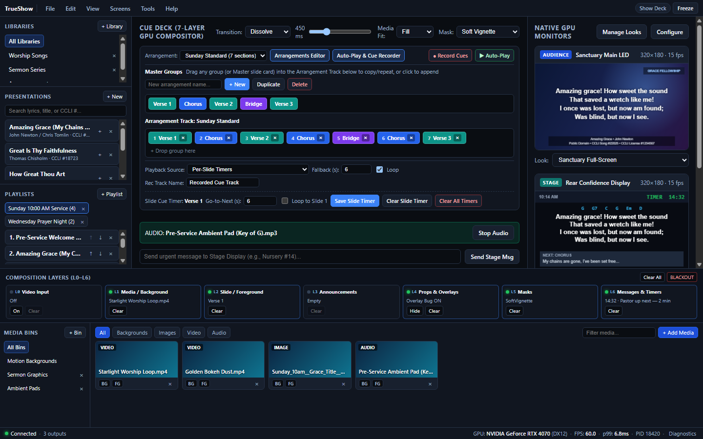

### 6.1 Creating & Reordering Song Arrangements

Just like ProPresenter's Master vs. Arrangement workflow, TrueShow keeps every song's original slides safely in its **Master** order while letting you save unlimited custom arrangements (e.g., `Sunday Standard`, `Acoustic Short`, `Youth Night`) persisted directly in SQLite:

1. **Switch Arrangements:** Use the **`Arrangement`** dropdown (`Master` or any saved arrangement) to immediately reshape the Cue Deck slide sequence live.
2. **Create, Duplicate or Delete:** Type a name in `New arrangement name...` and click **`+ New`**, click **`Duplicate`** to clone the active arrangement, or click **`Delete`** to remove it.
3. **Drag-and-Drop Groups or Slides (Copy & Repeat Sections):**
   - **Master Groups Palette:** Drag any color-coded group token (`Verse 1`, `Chorus`, `Verse 2`, `Bridge`, `Verse 3`) into the **Arrangement Track** below — or simply click it to append it to the end. You can drop `Chorus` or `Bridge` as many times as needed without duplicating lyrics!
   - **Drag Directly from Master Slide Cards:** You can also drag any slide card straight from the Master deck into the Arrangement Track to insert its section group at an exact slot.
   - **Reorder & Remove:** Drag any numbered pill inside the **Arrangement Track** left or right to reorder sections, or click its **`×`** button to remove that instance. If you edit while `Master` is selected, TrueShow automatically creates a new `Custom Arrangement` so your Master slides are never overwritten.

---

### 6.2 Recording Live Cues & Running Auto-Play

Need slides to advance automatically with a backing track, click track, announcement loop, or timed presentation?

1. **Live Cue Recording (`● Record Cues`):**
   - Optionally set a name in **`Rec Track Name`** (e.g., `Sunday Band Click Track (76 BPM)`).
   - Click **`● Record Cues`** in the strip bar. A live red timer (`● REC 00:08.4 (3 cues)`) begins counting with `0.1s` precision.
   - Simply click through your slides (or press `Space`/`ArrowRight`) in real time with the music or speaker. Every slide trigger and dwell time is captured automatically.
   - Click **`■ Stop & Save Rec`**. TrueShow saves the recorded `AutoPlayTrack` to SQLite for that song **and** stamps each slide's individual `auto_advance_secs` timer!
2. **Running Auto-Play (`▶ Auto-Play`):**
   - Choose your **`Playback Source`**: either **`Per-Slide Timers`** (uses each slide's `⏱` timer, falling back to `Fallback (s)`) or any saved **Recorded Cue Track**.
   - Check **`Loop`** if you want playback to restart automatically from the beginning (great for pre-service announcement loops!).
   - Click **`▶ Auto-Play`**. A green live countdown pill (`▶ AUTO · Next in 4.2s`) appears; click **`■ Stop Auto-Play`** at any time to take back manual control.

---

### 6.3 Per-Slide Timers & Looping Slideshows

You can also fine-tune any individual slide's timing:
- Select a slide (or **right-click any slide → `Set Auto-Play Timer…`**).
- Enter **`Go-to-Next (s)`**, optionally check **`Loop to Slide 1`** (for the final slide of a looping announcement deck), and click **`Save Slide Timer`**.
- Use **`Clear Slide Timer`** to remove the timer from the current slide, or **`Clear All Timers`** to reset the entire presentation.

---

## 7. Scripture Lookup & Dual-Translation Slides

Open via **View → Scripture Drawer** (or **File → Scripture Lookup**).

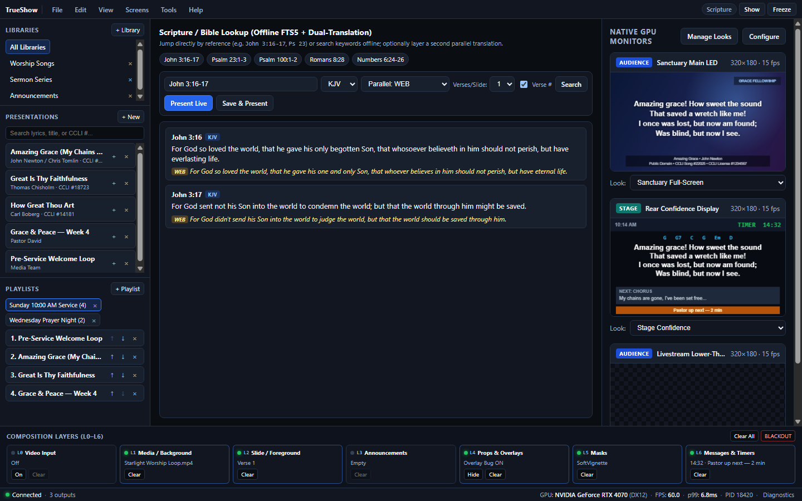

TrueShow includes built-in Public Domain **KJV** and **WEB** Bible passages indexed in local SQLite FTS5 (plus you can import additional OSIS XML Bibles in **Tools → Import & PCO**):

1. **Quick Reference Chips:** Click preset passages (`John 3:16-17`, `Psalm 23:1-3`, `Psalm 100:1-2`, `Romans 8:28`, `Numbers 6:24-26`) for instant lookup.
2. **Reference or Keyword Search:** Enter any reference (`John 3:16-17`, `Ps 23`, `Rom 8:28`) **or** plain keywords (`shepherd`, `love`, `peace`) and click **`Search`**.
3. **Dual-Translation Parallel Slides:** Select a primary translation (e.g., `KJV`) and optionally pick a second translation in the **`Parallel`** dropdown (e.g., `WEB`) to display both translations together on every slide — ideal for bilingual or comparative teaching!
4. **Layout Controls:** Choose **`Verses/Slide`** (`1`, `2`, `3`, etc.) and toggle **`Verse #`** numbers on/off.
5. **Present or Save:**
   - **`Present Live`** builds the formatted Scripture slides and loads them straight into the Cue Deck immediately.
   - **`Save & Present`** saves the Scripture passage as a reusable presentation in your library *and* loads it into the Cue Deck.

---

## 8. Quick Lyrics & Bilingual Authoring

Open via **View → Quick Lyrics** (or **File → Quick Lyrics & Arrangements**).

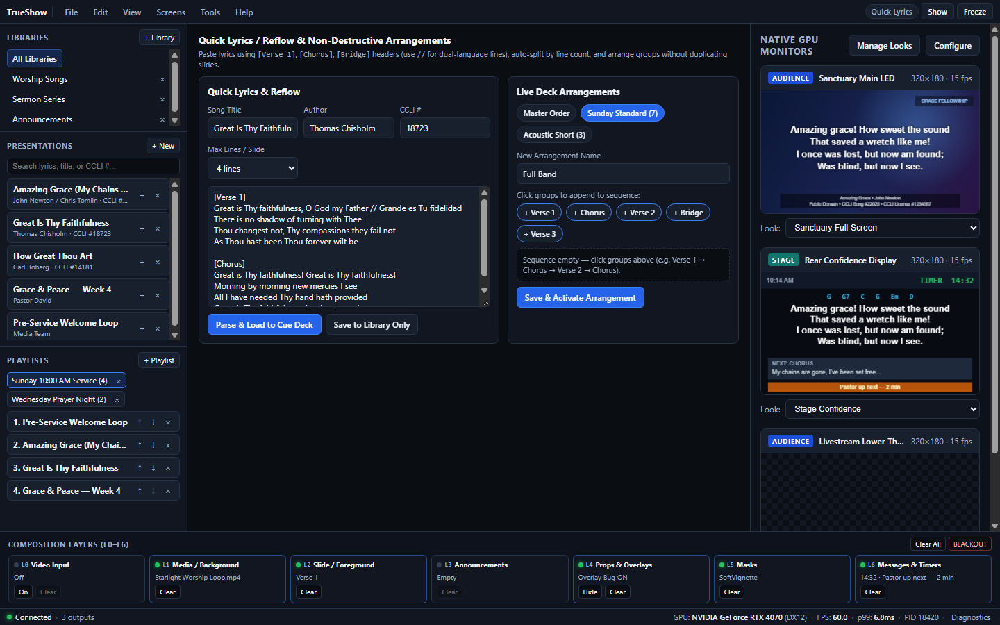

Quick Lyrics is the fastest way to paste or type a brand-new song and break it into properly grouped, stage-ready slides in seconds:

1. **Metadata Fields:** Enter **Song Title**, **Author**, **CCLI #**, and **Max Lines / Slide** (default `4` — automatically splits long stanzas into clean multi-slide chunks!).
2. **Section Tags:** Start sections with `[Verse 1]`, `[Chorus]`, `[Pre-Chorus]`, `[Bridge]`, `[Tag]`, or `[Ending]` to automatically assign color-coded group badges.
3. **Dual-Language (`//`) Support:** Put `//` between two languages on any line (for example: `Great is Thy faithfulness, O God my Father // Grande es Tu fidelidad`) to create clean stacked bilingual lyrics automatically.
4. **Save & Load:** Click **`Parse, Save & Load Live`** to persist the song in `Worship Songs` and load it into the Cue Deck, or **`Save to Library Only`** to prepare songs ahead of time without interrupting your current deck.
5. **Quick Arrangement Builder:** Use the bottom arrangement section to assemble and save a custom section order right after authoring your lyrics.

---

## 9. Overlays / Props, Audience Messages & Dynamic Variables

Open via **Edit → Overlays & Messages**.

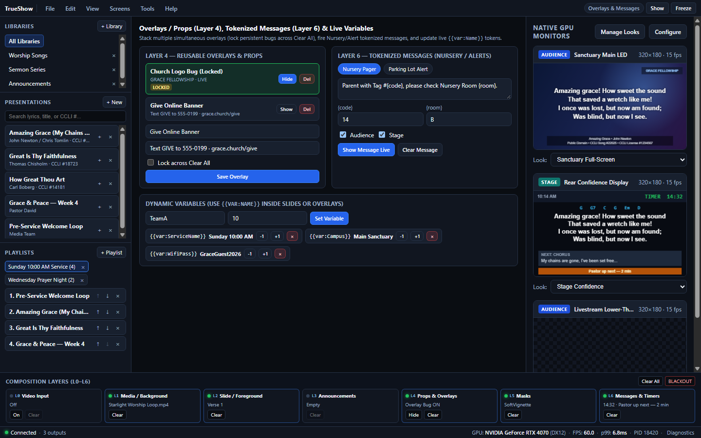

This panel controls Layers 4 (`Props & Overlays`) and 6 (`Messages & Timers`) plus live data-driven variables:

1. **Multi-Item Overlays & Props (Layer 4):**
   - Turn multiple overlays on or off simultaneously (e.g., a permanent church watermark bug + a temporary `"Give Online"` lower-third banner).
   - **Locked Overlays (`Lock` checkbox):** Marking an overlay as **Locked** protects it from **`Clear All` (`F1`)** — ensuring your church logo or livestream watermark stays on air even when clearing slides and banners between songs!
   - Configure each overlay's **Name**, **Text**, and exact 1920×1080 coordinates (`X`, `Y`, `Width`, `Height`), then save or delete it.
2. **Audience & Stage Message Templates (Layer 6):**
   - Create reusable templates with curly-brace tokens — for example: `Parent with Tag #{code}, please check Nursery Room {room}.`
   - TrueShow automatically detects every `{token}` and generates quick fill-in boxes (`code`, `room`).
   - Check **`Audience`** and/or **`Stage`** to route the alert to the congregation, the stage display, or both, then click **`Show Message Live`** (or **`Clear Message`** when done).
3. **Live Dynamic Variables (`{{var:Name}}`):**
   - Define global key-value variables (such as `ServiceName = Sunday 10:00 AM`, `Campus = Main Sanctuary`, `WifiPass = GraceGuest2026`).
   - Reference them inside any slide or overlay using **`{{var:ServiceName}}`**, alongside built-in live tokens **`{{timer}}`**, **`{{clock}}`**, and **`{{ccli}}`**. Updating a variable updates every slide using it instantly!

---

## 10. WYSIWYG Slide Editor

Open via **Edit → Slide Editor** (or **right-click any slide in the Cue Deck → `Edit in Slide Editor`**).

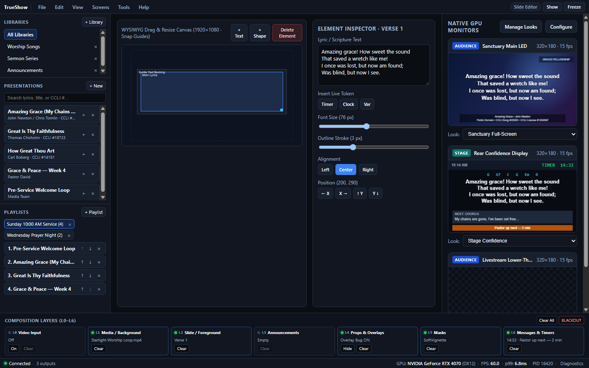

The WYSIWYG Slide Editor lets you visually position and style text boxes and shapes on a 1920×1080 virtual canvas with live GPU feedback:

- **Direct Manipulation:** Click any element on the canvas to select it, **drag it** to reposition (with automatic center snap guides!), or drag the **bottom-right resize handle** to resize.
- **Add / Delete Elements:** Click **`+ Text`** to add a new text box, **`+ Shape`** to add a backing rectangle/lower-third bar, or **`Delete Element`** to remove the selected item.
- **Element Inspector (Right Pane):**
  - Edit **`Lyric / Scripture Text`** directly.
  - One-click **`Insert Live Token`** buttons for **`Timer`** (`{{timer}}`), **`Clock`** (`{{clock}}`), and **`Var`** (`{{var:Name}}`).
  - Adjust **`Font Size`**, **`Outline Stroke`**, horizontal **`Alignment`** (`Left`, `Center`, `Right`), and pixel-accurate **`Position`** nudge buttons (`← X`, `X →`, `↑ Y`, `Y ↓`).
- Every change commits directly to the GPU engine so you immediately see the real rendered result on your Native GPU Monitors.

---

## 11. Screens, Physical Monitor Splitting & Multi-Projector GPU Edge Blending

Open via **Screens → Configure Screens & Monitors** (or click **`Configure`** above Native GPU Monitors).

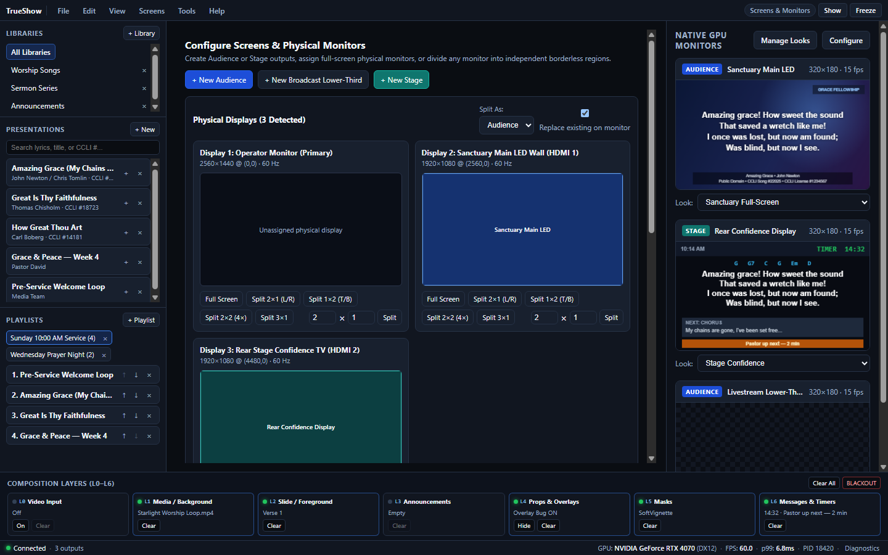

### Physical Displays & Borderless Grid Splitting

At the top, TrueShow automatically lists every connected physical display (resolution, coordinates, refresh rate) and shows which logical screens are mapped onto each display:

- **Quick Screen Presets:** Click **`+ New Audience`**, **`+ New Broadcast Lower-Third`**, or **`+ New Stage`** to spin up a new GPU output immediately.
- **Full-Screen Assignment:** Click **`Full Screen`** under any detected monitor to map an output across the entire display.
- **Borderless Multi-Region Splitting:** Have an ultra-wide LED processor, Matrox TripleHead2Go, or dual-monitor matrix? Pick **`Split As`** (`Audience` or `Stage`), optionally check **`Replace existing on monitor`**, and click **`Split 2×1 (L/R)`**, **`Split 1×2 (T/B)`**, **`Split 2×2 (4×)`**, **`Split 3×1`**, or enter any custom **`Cols × Rows`** and click **`Split`** to divide a single physical display into independent borderless GPU viewports!

### Creating Screens, Managing Outputs & GPU Soft-Edge Blending

Scrolling down reveals the **Create New Screen** form, **Configured Outputs** list, and **Multi-Projector Soft-Edge Blending & Color Calibration (GPU)**:

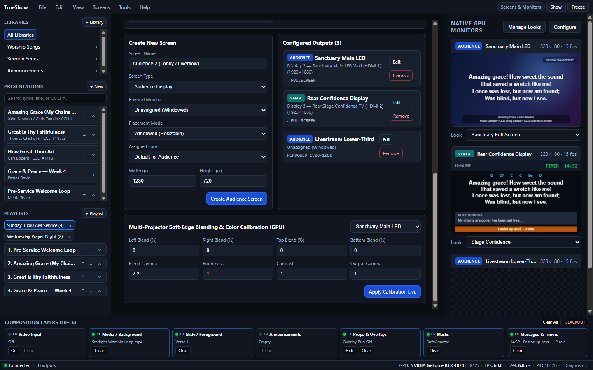

- **Create / Edit / Remove Outputs:** Customize any output's Name, Screen Type (`Audience Display` or `Stage Confidence`), Physical Monitor assignment, Placement Mode (`Fullscreen`, `Windowed`, or exact `Region`), Assigned Look, and pixel dimensions (`Width × Height`).
- **Multi-Projector Soft-Edge Blending & Color Calibration (GPU):** Select any configured output from the dropdown and dial in hardware-accelerated WGSL shader calibration:
  - **Edge Feathering (`Left`, `Right`, `Top`, `Bottom Blend %`):** Smoothly feathers overlapping projector seams from `0%` to `45%`.
  - **Blend Gamma (`default 2.2`):** Tunes the optical falloff curve so dual-projector overlaps disappear seamlessly.
  - **Color Calibration (`Brightness`, `Contrast`, `Output Gamma`):** Matches color temperature and luminance across mismatched projectors or LED panels.
  - Click **`Apply Calibration Live`** to update the GPU shader immediately without recreating windows.

---

## 12. Looks, Multi-Screen Look Routing & Slide Templates

Open via **Screens → Looks & Templates** (or click **`Manage Looks`** above Native GPU Monitors).

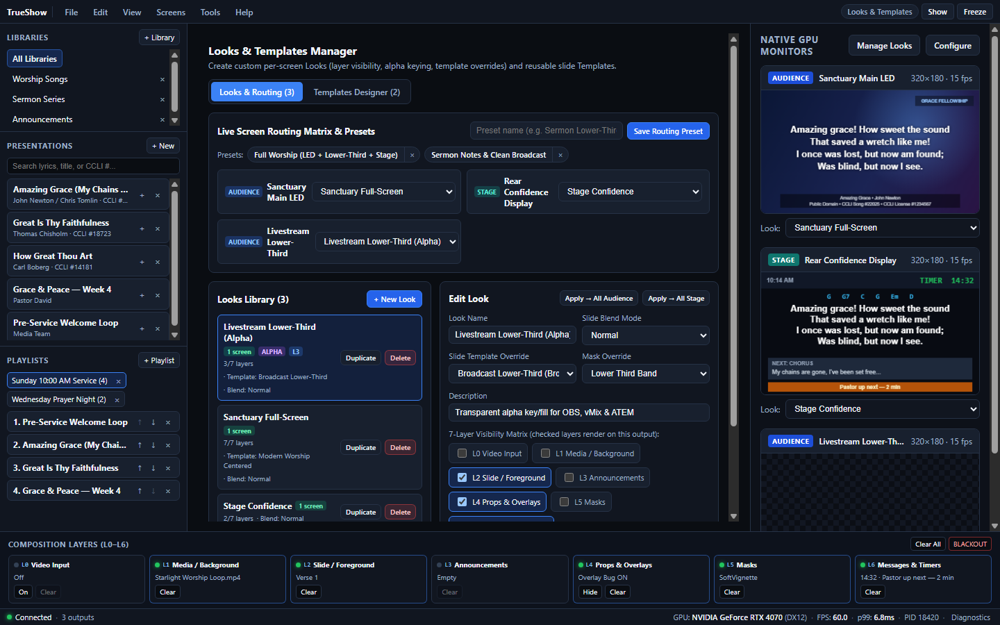

**Looks** let the exact same slide trigger look completely different on every screen simultaneously — for example, full-screen centered lyrics over a motion background on your **Sanctuary Main LED**, transparent lower-third text on your **Livestream**, and chords + next slide on your **Stage Display**:

1. **Live Screen Routing Matrix & Presets:**
   - Assign any Look to each configured screen via dropdowns.
   - Save your entire multi-screen routing setup as a named **Routing Preset** (e.g., `Full Worship (LED + Lower-Third + Stage)` vs. `Sermon Notes & Clean Broadcast`) and recall it in a single click during a service!
2. **Looks Library (`+ New Look`, `Duplicate`, `Delete`):**
   - Toggle individual **7-layer checkboxes (`L0`–`L6`)** to control exactly which layers render on screens using this Look.
   - Toggle **Lower-Third Mode** and **Transparent Background (Alpha)** for livestream key/fill overlays.
   - Optionally attach a **Slide Template Override** and **Mask Override** (`SoftVignette`, `LowerThirdBand`, etc.), or use **`Apply → All Audience`** / **`Apply → All Stage`**.
3. **Templates Designer Tab:**
   - Switch to the **`Templates Designer`** tab to design reusable slide typography, text bounds, subtitle styles, accent bars, and default masks — then apply a template to either the **active slide** or the **entire Cue Deck** in one click.

---

## 13. Visual Stage Confidence Display Designer

Open via **Screens → Stage Layout Designer** (or right-click any Stage output → **`Stage Layout Designer`**).

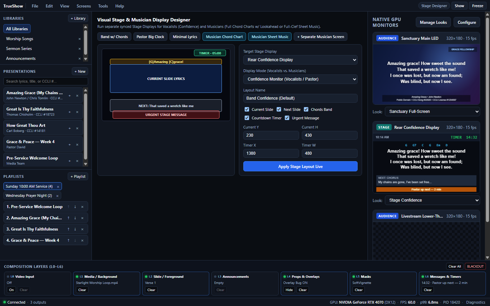

Customize what your worship team and speakers see on the back-wall confidence monitor:

1. **One-Click Stage Presets (Vocalists vs. Musicians):**
   - **`Band w/ Chords`** — Vocalist/Band confidence view with Current Slide, compact chords above, Next Slide preview, Countdown Timer, and Stage Message.
   - **`Pastor Big Clock`** — Giant easy-to-read countdown clock at the top, speaker notes/current slide in the middle, next slide below, chords hidden.
   - **`Minimal Lyrics`** — Maximum-size current lyrics only for distraction-free vocalists.
   - **`Musician Chord Chart`** — Dedicated musician display showing the **entire active section** (never truncated to vocalist slide lines!) with aligned monospaced chords + lyrics on the left AND **1–4 upcoming lookahead sections / extra context lines** on the right, plus live **per-display Key Transposition (`-6` to `+6` semitones)**!
   - **`Musician Sheet Music`** — Dedicated musician display showing **full grand-staff / full-clef sheet music pages** (1 full page or **2-Page Side-by-Side Spread** with optional **Dark Stage Paper Invert**) that automatically turn pages in sync with your presentation slides!
2. **Running a Separate Synced Musician Stage Display:**
   - Click **`+ Separate Musician Screen`** right in the Stage Designer header to create an independent second Stage output (separate from your Vocalist Stage Display) that stays 100% locked in sync with every live slide change.
   - Band members on iPads/tablets can also open **`http://<LAN-IP>:8765/musician`** (listed in **Screens → Broadcast I/O & LAN Remote**) for live WebSocket-synced Chord Charts (with independent local Transpose!) and Full-Clef Sheet Music page turns.
3. **Importing Chord Charts & Sheet Music (Local PDF / ChordPro / Images & Planning Center):**
   - In **Tools → Import & Planning Center**, use **Section 1B** to import local **Chord Chart PDFs / ChordPro (`.cho`/`.crd`)** or **Sheet Music PDFs / Page Image Folders** directly onto the active song (persisted in SQLite).
   - Planning Center PDF attachments automatically classify into `LYRICPDF`, `CHORDCHARTPDF`, and `SHEETMUSICPDF` — and any PDF attachment lets you click **`Lyrics`**, **`Chord Chart`**, or **`Sheet Music`** directly.
4. **Zone Toggles & Coordinates:** Select your **`Target Stage Display`**, pick the **`Display Mode`** (`Confidence`, `ChordChart`, or `SheetMusic`), configure lookahead / transpose / 2-page spread or confidence zones, and click **`Apply Stage Layout Live`**.

---

## 14. Broadcast Video I/O, Virtual Outputs & LAN Mobile Web Remote

Open via **Screens → Broadcast I/O & LAN Remote**.

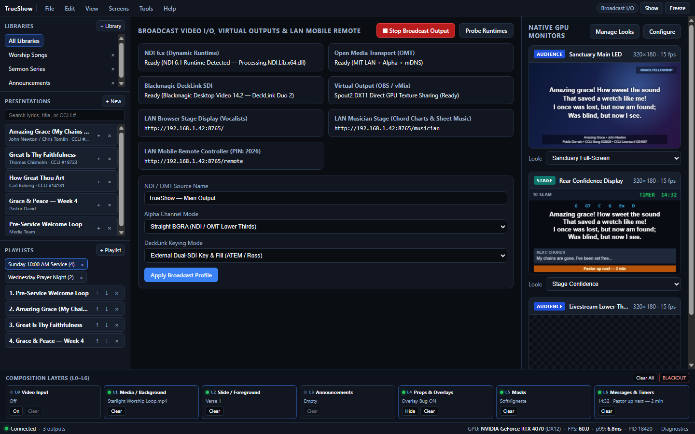

### Broadcast Video Outputs & Runtime Probing

Click **`Probe Runtimes`** at any time to detect installed broadcast drivers (TrueShow loads proprietary drivers dynamically at runtime and never bundles proprietary SDK DLLs):

- **NDI 6.x (Dynamic Runtime):** Sends live video + straight or premultiplied alpha over gigabit Ethernet to OBS, vMix, TriCaster, or Wirecast.
- **Open Media Transport (OMT):** Built-in open-source (MIT) low-latency LAN video + alpha + mDNS discovery transport.
- **Blackmagic DeckLink SDI:** Supports **`External Dual-SDI Key & Fill (ATEM / Ross)`** or **`Internal Keyer`** for hardware broadcast switchers.
- **Virtual Output (OBS / vMix):** Zero-copy GPU texture sharing via **Spout2** (Windows) or **Syphon** (macOS).
- Configure your **NDI / OMT Source Name**, **Alpha Channel Mode** (`Straight BGRA`, `Premultiplied BGRA`, or `Key/Fill Split`), and **DeckLink Keying Mode**, click **`Apply Broadcast Profile`**, and use **`● Start Broadcast Output` / `⏹ Stop Broadcast Output`** to go live.

### LAN Browser Stage Display & PIN-Protected Mobile Remote Controller

TrueShow automatically detects your machine's real LAN IPv4 address and hosts two zero-install browser apps on your local network:

1. **LAN Browser Stage Display** (e.g., `http://192.168.1.42:8765/`): Open on any iPad, tablet, or secondary laptop on church Wi-Fi for an extra real-time WebSocket stage confidence monitor.
2. **LAN Mobile Remote Controller** (e.g., `http://192.168.1.42:8765/remote`, default **PIN: `2026`**): Lets a pastor, worship leader, or roving tech volunteer control slides (`Prev`/`Next`), trigger `Blackout` / `Clear`, and draw live on-screen annotations using the touch **Telestrator Laser Pointer** right from their phone!

---

## 15. Tools Suite: Live Timers, Macros, Calendar Schedule & OSC / Companion

The **Tools** menu organizes automation, importing, CCLI compliance, and backups into **5 clean, focused sub-pages** (accessible both from the top **Tools** menu and via the horizontal tab bar at the top of the panel).

### 15.1 Live Timers (`Tools → Live Timers`)

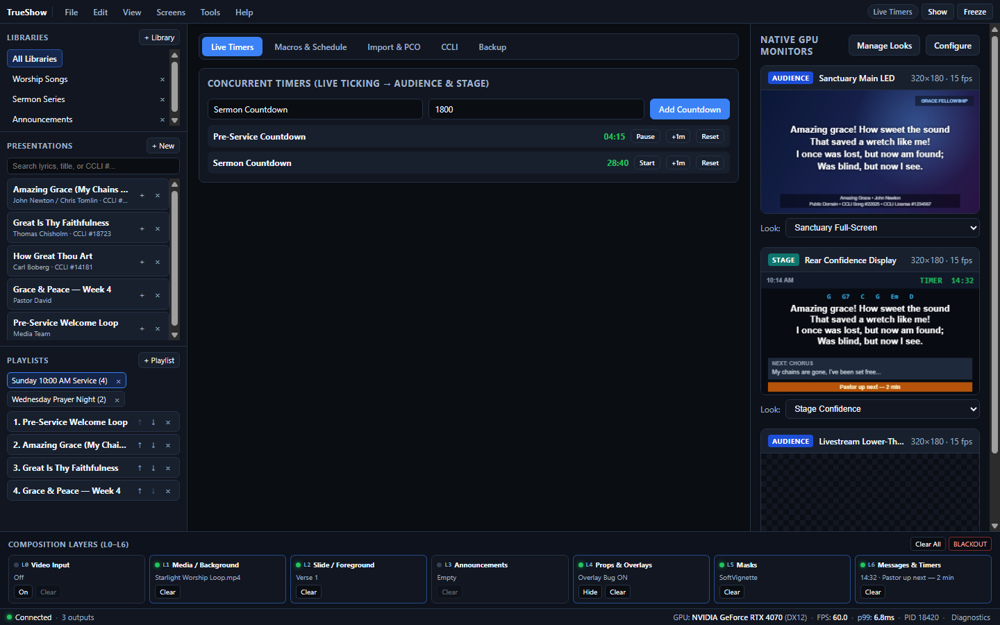

- Enter a **Timer Name** (e.g., `Sermon Countdown` or `Pre-Service Countdown`) and duration in **seconds** (e.g., `1800` = 30:00), then click **`Add Countdown`**.
- Run multiple concurrent timers simultaneously. Each timer row provides live **`Start` / `Pause`**, **`+1m`** (add 1 minute on the fly while speaking), and **`Reset`** controls.
- Timers automatically tick once per second, feed live **`{{timer}}`** tokens on Audience slides and Stage confidence monitors, and switch to red **overrun** formatting if a speaker goes past `00:00`.

---

### 15.2 Macros, Calendar Schedule & OSC / Bitfocus Companion (`Tools → Macros, Calendar & OSC`)

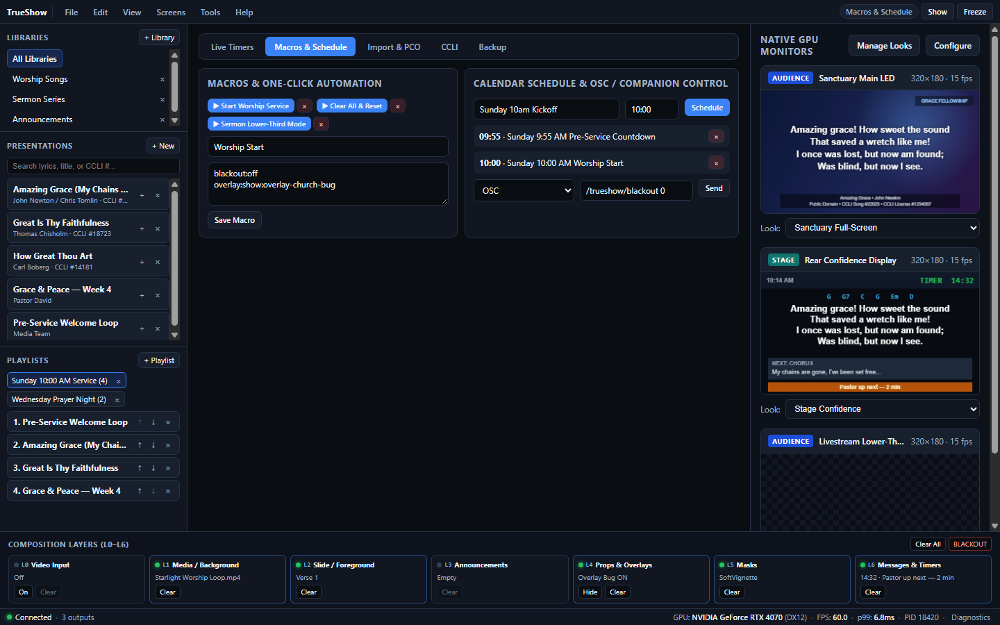

- **Macros & One-Click Automation (Left Card):**
  - Chain multiple actions into a single one-click button (for example: `blackout:off` + `overlay:show:ov-bug`, or `clear:all` + `blackout:off`).
  - Enter a **Macro Name** and one step per line in **Macro Steps**, then click **`Save Macro`**. Click any blue **`▶ Macro`** pill to execute it live, or `×` to delete it.
- **Calendar Schedule (Right Card — Top):**
  - Schedule any saved macro to fire automatically at an exact wall-clock **`HH:MM`** time (e.g., `09:55` Pre-Service Countdown, `10:00` Worship Start).
- **OSC & Bitfocus Companion Control (Right Card — Bottom):**
  - Select **`OSC`**, **`Bitfocus Companion`**, or **`Macro Step`**, enter a command (such as `/trueshow/blackout 0`), and click **`Send`** to test or trigger external hardware/lighting/stream-deck integrations.

---

## 16. Importing Presentations, Lyric Sheet PDFs, PowerPoint, Keynote, Images & Planning Center

Open via **Tools → Import & Planning Center** (or **File → Import Files & Planning Center…**).

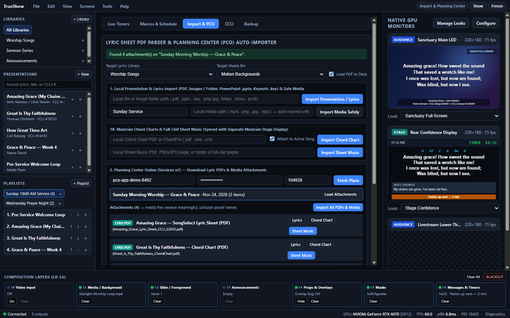

### 16.1 Choosing Target Libraries & Media Bins

Before importing any song, slide deck, or media file, choose exactly where it should be stored at the top of the panel:
- **`Target Lyrics Library`:** Selects which Presentation Library receives imported songs, PDFs, PowerPoint/Keynote decks, or image slideshows (e.g., `Worship Songs`, `Sermon Series`, `Announcements`).
- **`Target Media Bin`:** Selects which Media Bin receives imported videos, images, and audio files (e.g., `Motion Backgrounds`, `Sermon Graphics`, `Ambient Pads`).
- **`Load PDF to Deck` checkbox:** When checked, newly imported presentations automatically load into your Cue Deck so you can review them immediately.

---

### 16.2 Local Presentation & Lyrics Import (PDF, Images, PPTX, Keynote, FreeShow, ProPresenter)

In **Section 1**, enter a local file path — or an entire **image folder path** — and click **`Import Presentation / Lyrics`**. TrueShow automatically detects the format by file extension:

| Format | Extensions | How TrueShow Imports It |
| :--- | :--- | :--- |
| **Lyric Sheet & Chord Chart PDF** | `.pdf` | Pure-Rust PDF text & `/FlateDecode` stream parser extracts lyrics, strips SongSelect footers, separates guitar chords onto Stage chord strips, builds color-coded Verse/Chorus/Bridge slides, and auto-detects **CCLI Song #**, **Author**, **Copyright**, and **Arrangements**! |
| **Single Image or Folder of Images** | `.png`, `.jpg`, `.jpeg`, `.bmp`, `.webp`, or a folder path | Turns a single graphic or an entire sorted folder of announcement/sermon slides into a ready-to-present slide deck (with every image safely hashed into your local library). |
| **Microsoft PowerPoint** | `.pptx` | Unpacks OOXML slides, extracts slide titles, bullet text, and embedded slide visuals directly into native TrueShow slides. |
| **Apple Keynote** | `.key` | Parses Keynote package archives (XML text & embedded slide preview images) into clean presentation slides. |
| **Other Worship Suites** | `.show` (FreeShow), `.pro6` (ProPresenter), `.xml` (OpenSong / OpenLyrics), `.cho`/`.crd` (ChordPro), `.usr` (SongSelect) | Clean-room native parsers preserve song metadata, CCLI numbers, and section groupings. |

---

### 16.3 Collision-Safe Local Media Import

Ever had two different presentations both contain a file named `Title.png` or `Intro.mp4`? TrueShow prevents accidental overwrites automatically:

- Enter a **`Media Context Label`** (such as the presentation or service name, e.g., `Sunday Service`) and a **`Safe Media File Path`**, then click **`Import Media Safely`**.
- TrueShow copies and hashes the file using a **collision-proof meaningful naming scheme**:
  ```text
  {context}__{original_stem}__{blake3_hash8}.{ext}
  Example: Sunday_10am__Grace_Title__4f9a12c8.png
  ```
- If the exact same media bytes already exist in your library, TrueShow deduplicates it cleanly instead of wasting disk space; if two files share a name like `slide1.png` with different contents, both coexist safely with zero overwriting!

---

### 16.4 Planning Center Online (Services v2) Attachments Importer

In **Section 2**, connect directly to your church's **Planning Center Services** account (bring-your-own credentials — zero hardcoded keys):

1. Enter your **PCO App ID** (or OAuth **Bearer Token**), **PCO Secret** (leave blank if using a Bearer Token), and **Service Type ID**, then click **`Fetch Plans`**.
2. Click **`Load Attachments`** next to any upcoming service plan.
3. TrueShow lists every attached **SongSelect Lyric Sheet / Chord Chart PDF (`LYRICPDF`)**, **Image (`IMAGE`)**, **Video (`VIDEO`)**, and **Audio (`AUDIO`)** attachment on that plan.
4. Click **`Import Lyrics`** or **`Import Media`** on any individual attachment — or click **`Import All PDFs & Media`** to batch-import the entire service into your chosen Target Lyrics Library and Target Media Bin with collision-safe naming!

---

### 16.5 Paste Worship Document Importer

Below the PCO card, you can also paste raw text directly in **ChordPro (`.cho`/`.crd`)**, **CCLI SongSelect (`.usr`)**, **Plain Text Stanzas**, **Bible XML (OSIS)**, **FreeShow (`.show` JSON)**, **OpenSong XML**, or **ProPresenter (`.pro6` XML)** format and click **`Import to Local Library`**.

---

## 17. Automated CCLI License & Song Attribution Display + CSV Audit Reports

Open via **Tools → CCLI Attribution & Reports**.

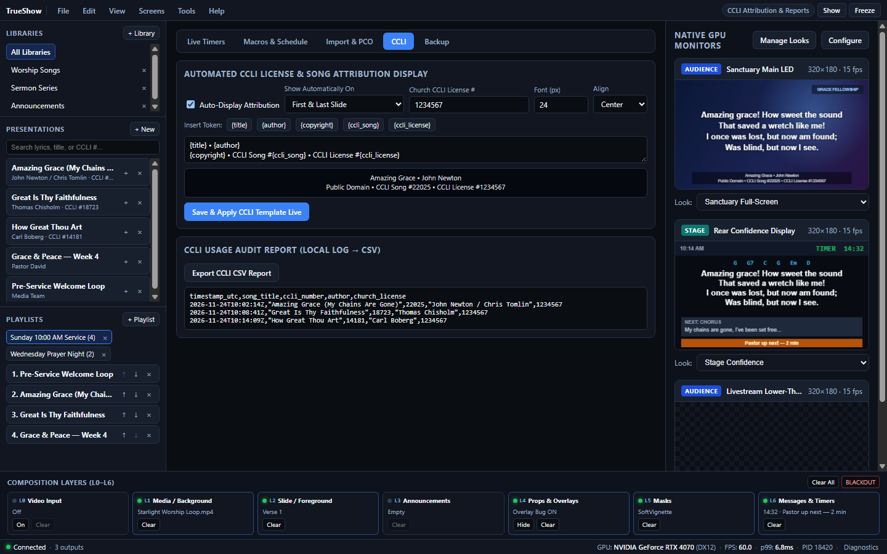

Stay 100% compliant with CCLI licensing rules automatically without manually pasting copyright footers onto every song:

1. **Enable & Placement:**
   - Check **`Auto-Display Attribution`** and pick **`Show Automatically On`**:
     - **`First Slide of Song`**
     - **`Last Slide of Song`**
     - **`First & Last Slide`**
     - **`Every Slide`**
     - **`Disabled`**
2. **Church License & Styling:**
   - Enter your **`Church CCLI License #`** (e.g., `1234567`), **`Font (px)`**, and **`Align`** (`Left`, `Center`, `Right`).
3. **Customizable Attribution Template + Live Preview:**
   - Click the **`Insert Token`** pills (`{title}`, `{author}`, `{copyright}`, `{ccli_song}`, `{ccli_license}`) to customize your exact multi-line footer template.
   - Verify the formatted output immediately in the dark **Live Preview** box directly beneath the editor, then click **`Save & Apply CCLI Template Live`**.
   - Your settings persist in SQLite and render directly on the GPU compositor whenever matching song slides go live!
4. **CCLI Usage Audit Report (Local Log → CSV):**
   - TrueShow automatically logs every licensed song presented live. Click **`Export CCLI CSV Report`** to generate a clean CSV table ready for CCLI Reporting.

---

## 18. Portable Full-Library Backup & Restore (`.tsbundle`)

Open via **Tools → Backup & Restore (`.tsbundle`)** (or **File → Backup & Restore (`.tsbundle`)…**).

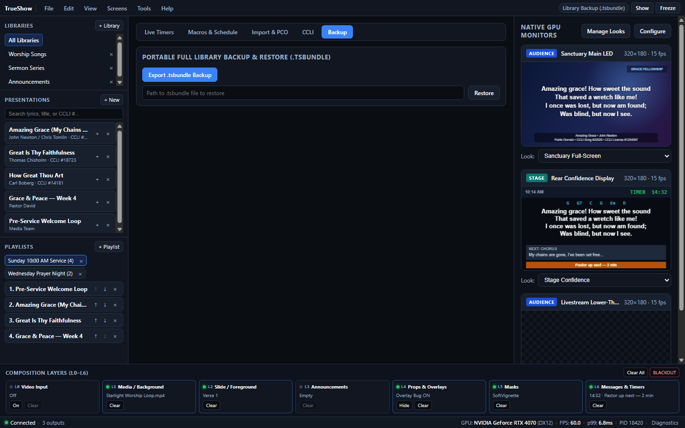

Move your church's entire presentation workstation to a backup laptop or archive your library before an upgrade in one click:

- **`Export .tsbundle Backup`:** Bundles your libraries, songs, arrangements, cue tracks, playlists, looks, templates, macros, scheduled events, and settings into a single portable `.tsbundle` file and displays its exact path and item count.
- **`Restore`:** Paste the path to any `.tsbundle` file and click **`Restore`** to hydrate another TrueShow workstation cleanly.

---

## 19. Diagnostics, Rolling Logs, Crash Reports & Recovery

Open via **Tools → Diagnostics & Logs** (or click **`Diagnostics`** on the far right of the bottom Status Bar).

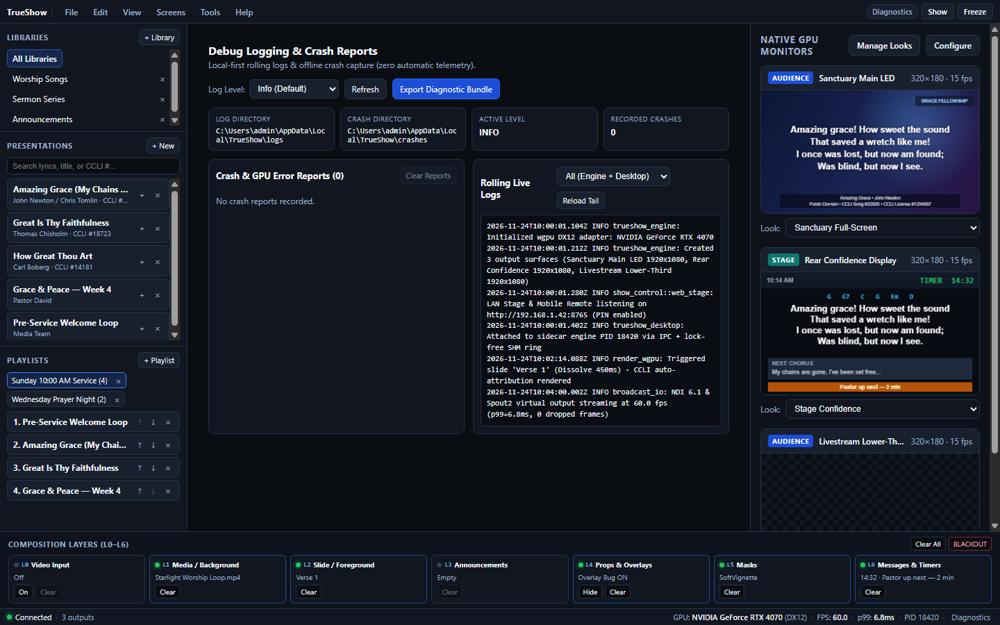

TrueShow is strictly **local-first with zero automatic telemetry**:

- **Live Log Verbosity (`Log Level`):** Switch both the Desktop UI and GPU Engine live between `Error`, `Warn`, `Info (Default)`, `Debug (Verbose)`, and `Trace (Full)` without restarting.
- **Rolling Live Logs:** Filter between `All (Engine + Desktop)`, `Engine Only`, or `Desktop UI Only`, and click **`Reload Tail`** to inspect the latest 150 lines.
- **Crash & GPU Error Reports:** Lists any captured engine or UI crashes (with a **`Clear Reports`** button once resolved).
- **`Export Diagnostic Bundle`:** Saves a single redacted Markdown diagnostic bundle containing system info, recent logs, and crash summaries so you can attach it safely to a bug report without leaking private credentials.

### Quick Recovery Checklist During a Live Service

| Situation | Fastest Recovery Action |
| :--- | :--- |
| Operator UI feels sluggish or needs a refresh while congregation is singing | Click **File → Reload UI (Keep Live)** — sanctuary screens stay live at 60 fps with zero flicker! |
| Status Bar says `Engine disconnected` | Click **`Reconnect`** right in the bottom Status Bar (or **File → Reconnect Engine**). |
| Wrong slide went live or accidental click | Press **`B`** (`BLACKOUT`) or **`F2`** (`Clear Slide Layer`), or **`Ctrl+Z`** (`Undo`), or **`F`** (`Freeze`) while fixing the deck. |
| Ready to pack up after service | Click **File → Shutdown All** to cleanly close both the operator UI and the GPU engine. |

---

## 20. Complete Keyboard Shortcuts Reference

All single-key operator shortcuts automatically pause whenever your cursor is typing inside a text box, search field, or dropdown so you never accidentally trigger Blackout while searching for a song.

| Shortcut | Action |
| :--- | :--- |
| **`Space`** / **`ArrowRight`** / **`PageDown`** | Advance to the **Next Slide** in the Cue Deck |
| **`ArrowLeft`** / **`PageUp`** | Go back to the **Previous Slide** in the Cue Deck |
| **`V`** | Jump directly to the first **`Verse`** slide in the active presentation |
| **`C`** | Jump directly to the first **`Chorus`** slide in the active presentation |
| **`G`** | Jump directly to the first **`Bridge`** slide in the active presentation |
| **`F1`** | **Clear All Layers** *(preserves Locked Overlays)* |
| **`F2`** | **Clear Slide Layer (L2)** *(leaves Background L1 running)* |
| **`B`** | Toggle **BLACKOUT** on all live outputs |
| **`F`** | Toggle **Freeze / Unfreeze** on all live outputs |
| **`Ctrl+Z`** *(or `Cmd+Z`)* | **Undo** last live scene change |
| **`Ctrl+Y`** / **`Ctrl+Shift+Z`** *(or `Cmd+Shift+Z`)* | **Redo** scene change |
| **`Escape`** | Close any open Menu Bar dropdown or Right-Click Context Menu |
