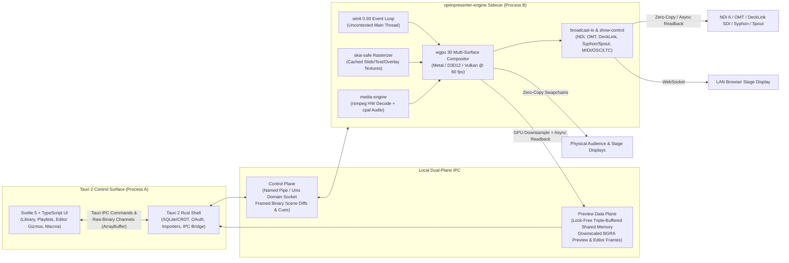

# Architecture Decision Record (ADR) — OpenPresenter

> **Status:** Accepted (Phase 1 Decisions Locked)  
> **Date:** November 2026  
> **Scope:** Cross-platform (Windows, macOS, Linux) broadcast-grade worship presentation engine built clean-room in Rust (+ targeted C++20 FFI) with a Tauri 2 operator control surface.

---

## Executive Summary

OpenPresenter separates the **real-time GPU compositing & broadcast engine** from the **operator control surface** at the OS process boundary, while keeping a single canonical scene graph so the operator editor matches physical outputs pixel-for-pixel.

| Architectural Axis | Recommendation | Primary Rationale |
| :--- | :--- | :--- |
| **Process Topology** | **Decoupled Sidecar Engine (`openpresenter-engine`)** + Tauri 2 Control Shell | Eliminates macOS `NSApplication`/`winit` vs `tao` main-thread conflicts; guarantees a WebView crash or UI reload never drops live sanctuary screens to black. |
| **Frontend Framework** | **Svelte 5 (TypeScript + Runes)** inside Tauri 2 (`v2.12+`) | Fine-grained signal reactivity with zero VDOM overhead for high-frequency live telemetry (timers, VU meters, scrubbers, live canvas feeds) and minimal memory footprint. |
| **Preview & Editor Pipeline** | **GPU-Rendered Native Frames -> Shared-Memory Ring -> Tauri Binary Channel (`ArrayBuffer`) + Thin Interactive Gizmo Overlay** | Pixel-for-pixel WYSIWYG parity with live outputs (zero HTML/CSS vs. GPU text drift) without fragile OS child-window z-ordering bugs. |
| **Typography & 2D Vectors** | **`skia-safe` (CPU-rasterized, GPU-cached layer textures)** behind an internal `Vector2DRasterizer` trait | Broadcast-ready strokes, Gaussian drop shadows, RTL/CJK shaping (`SkParagraph` + HarfBuzz/ICU), and exact caret hit-testing on Day 1, with zero GPU context conflicts against `wgpu`. |
| **Video Decode & Playback** | **Dynamic LGPL-2.1+ FFmpeg via `rsmpeg`** + OS hardware decoders (`VideoToolbox`, `D3D12VA`/`D3D11VA`, `VA-API`) -> `wgpu-hal` zero-copy import | Universal format support including ProRes 4444 + Alpha and WebM VP9 + Alpha; avoids GStreamer's 80+ plugin packaging bloat while staying strictly patent- and LGPL-hygienic. |
| **Broadcast & Virtual I/O** | `grafton-ndi` (NDI 6 dynamic), `libomt`/`libvmx` (MIT OMT), DeckLink C++20 FFI (Key/Fill), `syphon-wgpu` (macOS), `Spout2` D3D11On12 FFI (Windows) | Zero bundled proprietary SDK binaries; async 3-slot GPU staging readback ensures network/SDI sinks never stall the 60 fps render loop. |
| **Local-First Data & Sync** | **SQLite (`sqlx` + FTS5)** + **`loro` CRDT** + **Content-Addressed S3/R2 (`object_store`)** | 100% offline reliability on Sunday morning; movable-tree CRDT fits playlists/libraries; large 4K motion loops stay out of CRDT state. |

---

## System Topology Overview

---

## ADR-001: Decoupled Sidecar Engine vs. In-Process Rust Library

### Context
The live compositing engine owns physical display windows (`winit` + `wgpu`), hardware video decoders, broadcast sinks (NDI/OMT/DeckLink), and real-time audio/MIDI clocks. Tauri 2 runs its own OS windowing toolkit (`tao`) and platform WebViews (`WebView2` on Windows, `WKWebView` on macOS, `WebKitGTK` on Linux).

### Options Evaluated

| Criterion | Option A: Decoupled Sidecar Process (`openpresenter-engine`) | Option B: In-Process Rust Library inside Tauri 2 |
| :--- | :--- | :--- |
| **Crash Isolation (Zero-Blackout)** | **Excellent.** A WebView crash, JS OOM, or UI restart leaves all physical screens, motion loops, timers, and NDI/SDI feeds running uninterrupted. UI reconnects and re-hydrates state. | **Poor.** A WebView abort, Rust panic in UI/importer code, or Tauri restart immediately kills all output windows and drops sanctuary screens to black. |
| **macOS Main-Thread Ownership** | **Clean.** `openpresenter-engine` owns its own `NSApplication` / `winit` event loop; Tauri owns its own `tao` event loop. Zero conflict. | **Severe Risk.** macOS mandates all `NSWindow` / AppKit event handling on thread 0. Mixing `tao` (Tauri) and `winit` in one process is unsupported; forcing `wgpu` onto `tao` windows couples render-loop scheduling to WebView UI ticks. |
| **Native SDK Crash Blast Radius** | **Contained.** If a DeckLink driver update or malformed video file crashes the engine, SQLite/CRDT writes in the Tauri shell are unaffected and the watchdog auto-restarts the engine to the last committed cue in <500 ms. | **Global.** Any FFI segfault corrupts or terminates the entire application, risking dirty library state. |
| **IPC & Preview Complexity** | **Moderate.** Requires a local control socket (`interprocess`) + shared-memory ring buffer for preview frames and Tauri `bundle.externalBin` packaging. | **Low.** Direct in-memory function calls and `Arc` sharing. |
| **Future Headless / Remote Control** | **Native fit.** The engine is already controllable over a structured protocol, enabling multi-operator control or rack-mounted render nodes later. | **Requires rewrite** to decouple UI from renderer later. |

### Decision
Adopt **Option A: Decoupled Sidecar Engine Process (`openpresenter-engine`)**.

### Implementation Rules
1. **Packaging:** Ship `openpresenter-engine` via Tauri 2's `bundle.externalBin` target-triple sidecar mechanism (`openpresenter-engine-x86_64-pc-windows-msvc.exe`, `openpresenter-engine-aarch64-apple-darwin`, etc.).
2. **Lifecycle & Reconnection:**
   - The engine runs with a **session token** and local socket endpoint passed at launch (or discovered via a lockfile in the user runtime directory).
   - If the Tauri UI crashes or is reloaded by the operator, the engine **holds the current live scene indefinitely** (timers continue ticking, motion backgrounds continue looping) until the UI reconnects and receives a full `EngineSnapshot`.
   - Normal operator exit sends an explicit `Command::Shutdown` so no orphan processes linger.
3. **Dual-Plane Local IPC:**
   - **Control Plane (`interprocess` v2):** Windows Named Pipes / Unix Domain Sockets with length-prefixed `postcard` binary frames (typical cue round-trip <0.3 ms, well inside a 16.6 ms 60 fps budget).
   - **Preview Data Plane (`shared_memory` + atomics):** Per-bus triple-buffered shared memory ring (`AtomicU64` generation counters, lock-free reader/writer) so high-throughput preview pixels never serialize through the control socket.

---

## ADR-002: Operator Control Surface — Svelte 5 vs. React 19 (Tauri 2)

### Context
Tauri 2 (`v2.12+`) uses OS-native WebViews, meaning frontend CPU usage, garbage collection pauses, and memory pressure directly compete with the GPU compositor on modest church production laptops. The operator UI is strictly a control surface (slide grids, playlists, live preview monitors, inspector forms, macro/timer controls, settings) — never a live output renderer.

### Options Evaluated

| Criterion | Svelte 5 (TypeScript + Runes) | React 19 (TypeScript + Compiler) |
| :--- | :--- | :--- |
| **Runtime Footprint** | ~2–5 KB gzipped base runtime; direct compiled DOM updates. | ~42–45 KB gzipped base runtime; Virtual DOM reconciliation. |
| **High-Frequency Live State** (10–60 Hz timers, audio VU meters, LTC timecode, cue telemetry) | **Superior.** Fine-grained signals (`$state`, `$derived`) update only the exact DOM text/style nodes without tree diffing or GC spikes. | **Good with care.** React 19 Compiler reduces wasted renders, but high-frequency subscriptions still require careful external-store/ref bypasses to avoid jank. |
| **Third-Party UI Ecosystem** | Smaller than React, but mature headless primitives exist (Bits UI, Melt UI, Tailwind v4) for desktop chrome, split panes, virtual lists, and drag-and-drop. | Massive ecosystem of prebuilt tables, dock managers, and rich component kits. |
| **Contributor Familiarity** | Growing rapidly; very approachable syntax for TypeScript developers, though smaller pool than React. | Largest frontend developer pool globally. |

### Decision
Recommend **Svelte 5 + TypeScript** for the Tauri 2 operator UI.

### Rationale & Caveat
Because the hardest UI widget — the **WYSIWYG slide canvas** — is natively rendered by the Rust engine rather than implemented as a complex DOM/ProseMirror rich-text tree (see ADR-003), we do not rely on React-only rich-text frameworks. Svelte 5 minimizes background CPU/RAM interference on live show machines while keeping TypeScript bindings with Tauri 2 clean and idiomatic. *(Note: Revisit only if the founding team prioritizes React contributor onboarding over runtime lean-ness; see `04-open-questions-and-risks.md`.)*

---

## ADR-003: Single Source of Truth Scene Graph & Zero-Drift Preview / Editor Pipeline

### Context
A chronic failure mode of hybrid web/native presentation apps is **WYSIWYG drift**: the editor lays out text using HTML/CSS in a browser engine while the live output renders via native graphics APIs, causing line breaks, font weights, outlines, and shadows to disagree between the booth monitor and sanctuary projection.

### Decision: Native-Rendered Pixels + Thin WebView Gizmo Overlay

1. **Canonical Scene Graph (`core-scene`):**
   - Every slide, theme, lower-third, stage layout, and announcement is stored as a deterministic, resolution-independent graph (reference coordinate space, e.g., `1920×1080`, with explicit anchoring, aspect-fit rules, text-box margins, and per-screen **Look** overrides).
   - Both the live outputs and the operator editor consume the exact same `core-scene` structs and `render-text` / `render-wgpu` render passes.

2. **Three Distinct Preview & Editor Feeds:**

| Feed Type | Resolution & Rate | Transport Path | Frontend Target |
| :--- | :--- | :--- | :--- |
| **Live Program / Stage Monitors** (Multi-view in operator UI) | Configurable downscale (e.g., `640×360` or `960×540`) @ 30 fps (toggleable 60 fps) | `wgpu` GPU downsample pass -> 3-slot async `MAP_READ` staging ring -> Shared Memory -> Tauri 2 `Channel<tauri::ipc::Response>` (raw `ArrayBuffer`, zero base64/JSON) | WebGL2 `<canvas>` (`texSubImage2D` directly from `Uint8Array`, zero per-frame allocation) |
| **Slide Grid / Library Thumbnails** | `320×180` (on slide mutation only) | Engine renders dirty slides off-screen -> disk/LRU cache (WebP/PNG) -> Tauri 2 async custom URI scheme (`thumb://<content-hash>`) | Standard `` tags in virtualized grid |
| **Interactive Slide Editor Canvas** | Matches editor pane physical DPI (event-driven on edit, up to 60 fps during drag/scrub) | Shared Memory -> Tauri 2 raw binary `Channel<Response>` | WebGL2 `<canvas>` backdrop + **SVG/HTML interaction overlay** |

3. **How WYSIWYG Slide Editing Works Without DOM Text Drift:**
   - The Svelte editor renders **zero slide text or shapes via HTML/CSS**.
   - Instead, it renders the native engine's pixel output onto a WebGL2 `<canvas>`, overlaid with a lightweight transparent SVG layer for **selection handles, rotation gizmos, alignment snap guides, and resize bounding boxes**.
   - When the user double-clicks a text box to edit lyrics or Scripture:
     - A hidden/transparent native `<textarea>` captures OS keyboard shortcuts, dead keys, IME composition (CJK/Arabic/Hebrew), clipboard paste, and spellcheck.
     - Text mutations stream over the local control pipe to the engine (or directly invoke the shared `render-text` layout module), which re-renders the text layer in ~1–3 ms and returns exact **caret geometry and selection rectangles** for the SVG overlay to draw a crisp native-feeling blinking cursor.
   - **Result:** Line wrapping, auto-shrink font sizing, stroke widths, drop shadows, and RTL/complex script shaping match the physical sanctuary screens **100% pixel-for-pixel**.

4. **Why Native Child `wgpu` Window Overlays Were Rejected as Primary:**
   - Embedding a raw `HWND` / `NSView` `wgpu` surface directly inside a Tauri 2 WebView window avoids the CPU readback for the preview pane, **but** suffers from severe cross-platform z-ordering and clipping limitations: HTML context menus, modals, tooltips, and docked drawer popovers cannot cleanly render *above* a native child surface across Windows WebView2, macOS WKWebView, and Wayland/X11 without brittle window-region cutout hacks.
   - At `960×540×4` bytes (2.07 MB/frame) @ 30 fps, the shared-memory + Tauri binary `Channel` path transfers ~62 MB/s in RAM — negligible (<1% CPU) on modern systems — while preserving 100% standard CSS layout, modals, overlays, and cross-platform stability.

---

## ADR-004: Typography & 2D Vector Rendering — `skia-safe` vs. `vello` + `parley`/`cosmic-text`

### Context
Worship projection is overwhelmingly a **broadcast typography problem** over live motion video. Requirements include thick legible text outlines/strokes, soft Gaussian drop shadows, outer glows, gradient fills, pill backdrops, superscript verse numbers, chord-over-lyric alignment on Stage Displays, auto-fit shrinking, and full international script shaping (Latin, Greek, Hebrew RTL, Arabic RTL, CJK, Devanagari, color emoji).

### Options Evaluated (2026 State)

| Capability | `skia-safe` (Google Skia C++ wrapped in Rust) | `vello` + `parley` + `skrifa` + `harfrust` (Pure Rust / Linebender) | `cosmic-text` + `glyphon` (`wgpu`) |
| :--- | :--- | :--- | :--- |
| **Text Outlines / Strokes** | **Native & complete.** Exact `Stroke` / `StrokeAndFill` with miter/round joins and outside-stroke compositing. | Possible via path extraction (`skrifa`) + Vello stroke styles, but heavy for dynamic glyph runs unless atlas-cached. | **Missing natively.** Atlas-rasterized fills only; strokes require custom multi-pass SDF or offset shaders. |
| **Gaussian Drop Shadows & Glows** | **Native & complete.** `ImageFilters::drop_shadow` / `blur` directly on paints and layers. | Evolving in 2026 (maturing in `vello_cpu` / hybrid filter passes; GPU compute blur/filter chains still less complete than Skia). | **Not built-in.** Requires custom multi-pass `wgpu` render targets and separable blur shaders. |
| **Complex Script Shaping & Bidi** | **Battle-tested.** `SkParagraph` + HarfBuzz + ICU (same stack as Chrome/Flutter). | **Very strong.** `parley` + `harfrust` (pure-Rust HarfBuzz port) + `swash`. | **Strong.** Pure-Rust shaping, bidi, and fallback. |
| **Caret Hit-Testing for Editor** | **Built-in** (`Paragraph::get_glyph_position_at_coordinate`, `get_rects_for_range`). | Supported via `parley` cursor/selection APIs. | Supported via `cosmic-text::Editor`. |
| **GPU Interop with `wgpu` 30.x** | **Direct GPU sharing is brittle** (Skia Ganesh/Graphite vs `wgpu` device/fence ownership). **CPU raster -> `wgpu` texture upload is trivial & rock-solid.** | Native `wgpu` integration, though `vello` frequently lags behind `wgpu` major bumps (`wgpu` 30.x lockstep risk). | Native `wgpu`, subject to `wgpu` version lockstep. |
| **Build & Binary Footprint** | Prebuilt binaries via `skia-bindings` (fast builds for contributors); adds ~15–25 MB to release binary. | Pure Rust, minimal binary size, no C++ toolchain. | Pure Rust, minimal binary size. |
| **License** | MIT (`skia-safe`) + BSD-3-Clause (Skia). | Apache-2.0 / MIT. | MIT / Apache-2.0. |

### Decision
Adopt **`skia-safe` in headless CPU-rasterized, GPU-cached layer mode** encapsulated behind an internal `Vector2DRasterizer` trait in `crates/render-text`.

### Why CPU-Rasterized + GPU-Cached Skia Is the Architectural Sweet Spot
1. **Zero GPU Context Contention:** Skia never touches Metal/D3D12/Vulkan queues directly, completely eliminating cross-engine synchronization bugs against `wgpu` 30.x.
2. **Retained Dirty-Layer Performance:** Worship slides, lower thirds, and stage layouts are **event-driven**, not 60 fps procedural geometry. Rasterizing a 1080p lyric slide with outlines and drop shadows onto a premultiplied BGRA8 buffer takes **~1–3 ms on a background worker thread**, uploads once to a `wgpu::Texture` in an LRU GPU cache, and then composites across N outputs with 60 fps transitions (dissolve, push, wipe, iris, luma fade) at **0% CPU**.
3. **High-Frequency Text Cases Handled Cleanly:**
   - **Timers / Clocks:** Rasterize only the compact clock element bounding box (e.g., `320×90` px -> <0.15 ms) on tick (1 Hz–10 Hz).
   - **Scrolling Tickers / Marquees:** Rasterize the text strip once into a wide cached texture and scroll UV coordinates at locked 60 fps inside a `wgpu` shader.
4. **Future-Proof Escape Hatch:** Isolating `skia-safe` behind `render-text::Vector2DRasterizer` allows introducing a pure-Rust `vello` + `parley` backend once Vello's GPU filter/blur pipeline and `wgpu` version alignment mature, without changing `core-scene` or `render-wgpu`.

---

## ADR-005: Hardware Video Decode & Zero-Copy GPU Texture Import — FFmpeg (`rsmpeg`) vs. GStreamer (`gstreamer-rs`)

### Context
OpenPresenter must play simultaneous 1080p/4K60 H.264/H.265 looping motion backgrounds, alpha-channel motion overlays (**Apple ProRes 4444** and **WebM VP9+Alpha**), and foreground videos with frame-accurate looping and multi-channel audio, while honoring strict patent and open-source licensing hygiene.

### Options Evaluated

| Criterion | FFmpeg via `rsmpeg` (Dynamic LGPL-2.1+) | GStreamer via `gstreamer-rs` (Dynamic LGPL-2.1+) | OS-Native Only (AVFoundation + Media Foundation) |
| :--- | :--- | :--- | :--- |
| **Rust Maintenance (2026)** | **`rsmpeg` is actively maintained** with FFmpeg 6/7/8 support (MIT). *(Avoid `ffmpeg-next`, which is in maintenance-only mode; `ffmpeg-the-third` is a viable high-level fallback.)* | **`gstreamer-rs` is first-class** and actively maintained (MIT/Apache-2.0). | Fragmented across 3 completely separate platform FFI codebases. |
| **ProRes 4444 + Alpha & WebM VP9 + Alpha** | **Complete cross-platform support.** VideoToolbox HW decode on Apple Silicon; LGPL `prores` + `libvpx` SW decode on Windows/Linux. | Supported via plugins, but requires auditing `gst-plugins-good`/`bad`/`ugly` to avoid GPL plugins. | **Fails on Windows:** Media Foundation lacks native ProRes 4444 alpha and WebM VP9+Alpha side-stream support. |
| **Seamless Loop Precision** | **High.** Direct control over demuxer/decoder packets enables a clean dual-decoder pre-roll ring that swaps on the exact VSync frame with zero hitch. | **Tricky.** GStreamer segment-seeking (`GST_SEEK_FLAG_SEGMENT`) across hardware decoders frequently exhibits platform-specific frame drops or audio clicks. | High on macOS; complex on Windows. |
| **Packaging & Installer Hygiene** | **Clean.** 5–6 dynamic LGPL shared libs (`avcodec`, `avformat`, `avutil`, `swscale`, `swresample`) built strictly without `--enable-gpl` / `--enable-nonfree`. | **Heavy.** Bundling GStreamer on Windows/macOS drags in GLib, GObject, GIO, and 50–100+ plugin DLLs/dylibs + runtime plugin registry scanning. | Zero media libs bundled, but crippled codec matrix on Windows/Linux. |
| **Zero-Copy `wgpu` Interop** | Requires custom `unsafe` `wgpu-hal` import wrappers per OS (Metal `IOSurface`, D3D12 `ID3D12Resource`, Vulkan DMA-BUF). | Also requires custom `unsafe` `wgpu-hal` import wrappers (`d3d11videosink`/`vtdec` don't natively target `wgpu` 30). | Same `wgpu-hal` import wrappers required. |

### Decision
Adopt **dynamically linked LGPL-2.1+ FFmpeg via `rsmpeg`** (targeting FFmpeg 7.1 / 8.x), strictly compiled **without `--enable-gpl` and without `--enable-nonfree`** (excluding software x264/x265 encoders), delegating patent-encumbered H.264/HEVC decode to OS hardware decoders.

### Concrete Zero-Copy GPU Texture Import Feasibility

#### 1. macOS: VideoToolbox -> Metal -> `wgpu` (**Feasibility: High / Proven**)
- Configure `rsmpeg` with `AV_HWDEVICE_TYPE_VIDEOTOOLBOX`.
- Decoded `AVFrame->data[3]` yields a `CVPixelBufferRef` backed by an `IOSurfaceRef` (for H.264, HEVC, and **Apple Silicon hardware ProRes 4444 with alpha**!).
- Acquire the raw `MTLDevice` via `wgpu_device.as_hal::<wgpu::hal::api::Metal>()`.
- Call `MTLDevice::newTextureWithDescriptor:iosurface:plane:` for Plane 0 (`R8Unorm` Y, or `BGRA8Unorm`/`RGBA16Unorm` for packed alpha) and Plane 1 (`RG8Unorm` UV for NV12/P010).
- Wrap each `MTLTexture` into a `wgpu::Texture` via `unsafe { device.create_texture_from_hal::<wgpu::hal::api::Metal>(...) }`, keeping the `CVPixelBufferRef` retained until the GPU command buffer completes (via `queue.on_submitted_work_done`).
- A single WGSL compositor shader performs BT.709/BT.2020 YUV-to-RGB conversion and alpha compositing directly in VRAM — **zero CPU pixel copies**.

#### 2. Windows: D3D12VA / D3D11VA -> D3D12 -> `wgpu` (**Feasibility: Medium-High / Two-Tier**)
- **Primary Path (D3D12VA — FFmpeg 7.1+/8.x):**
  - Extract `wgpu`'s underlying `ID3D12Device` via `wgpu_device.as_hal::<wgpu::hal::api::Dx12>()` and pass it into FFmpeg's `AVD3D12VADeviceContext` so FFmpeg decodes H.264/HEVC/AV1/VP9 directly into an `ID3D12Resource` on the **exact same GPU device**.
  - Extract the `AVD3D12VAFrame` (`ID3D12Resource*` + `ID3D12Fence*` + fence value). Signal/wait on `wgpu`'s `ID3D12CommandQueue`, then wrap the Y and UV subresource planes via `create_texture_from_hal::<wgpu::hal::api::Dx12>()`.
- **Secondary Path (D3D11VA -> D3D12 Shared NT Handle):**
  - On older GPU drivers lacking D3D12VA codec support, decode via `AV_HWDEVICE_TYPE_D3D11VA` into a `D3D11_RESOURCE_MISC_SHARED_NTHANDLE` texture and open it on the `wgpu` D3D12 device via `ID3D12Device::OpenSharedHandle` + `ID3D12Fence`.
- **Automatic Safety Fallback & Alpha Video Path:**
  - Because Windows hardware video decoders do not decode **ProRes 4444** (`yuva444p10le`) or **WebM VP9+Alpha** (dual-stream Matroska `BlockAdditional` alpha matte), those codecs decode on a dedicated thread pool into planar Y/U/V/A buffers and stream into triple-buffered `wgpu` staging uploads, keeping YUVA->RGBA color math on the GPU shader. If a buggy GPU driver rejects D3D12VA/D3D11VA import at runtime, the engine gracefully falls back to this same staging path rather than crashing mid-service.

#### 3. Linux: VA-API -> DMA-BUF -> Vulkan -> `wgpu` (**Feasibility: Medium**)
- Decode with `AV_HWDEVICE_TYPE_VAAPI`, export DRM PRIME descriptors (`av_hwframe_map` / `AV_PIX_FMT_DRM_PRIME`), and import into Vulkan via `VK_EXT_external_memory_dma_buf` + `VK_EXT_image_drm_format_modifier` through `wgpu::hal::api::Vulkan`, with automatic CPU staging fallback on drivers lacking modifier interop.

#### 4. Seamless Looping & Multi-Channel Audio
- **Seamless Looping:** When a looping background reaches `duration - 500 ms`, a lightweight secondary packet reader pre-decodes the first 8 frames from PTS `0` into a warm ring buffer; on the exact wrap frame, the compositor switches seamlessly with zero black frames or decode spikes.
- **Audio Engine:** `cpal` (`v0.17+`) for CoreAudio, WASAPI (shared & exclusive), and PipeWire/ALSA + `symphonia` (pure-Rust audio decode for standalone tracks) + a custom lock-free planar multi-channel routing matrix (`rtrb` ring buffers; zero allocations/locks in the real-time audio callback) supporting independent buses (Main L/R, Stream Mix, Click/Guide, Stage Monitor). Steinberg ASIO on Windows is supported strictly as an **opt-in compile feature / external driver module** due to Steinberg's proprietary SDK license.

---

## ADR-006: Broadcast I/O, Virtual Outputs & Alpha Key/Fill Pipeline

### Decision
1. **GPU-Native Multi-Layer Compositor (`render-wgpu`):**
   - 7 independent stackable layers composited in linear/sRGB-aware premultiplied BGRA8/RGBA16F render targets per logical **Look**:
     1. `VideoInput` (Live NDI / OMT / Capture / Syphon / Spout)
     2. `MediaBackground` (Looping motion videos / stills / gradients)
     3. `Slide` (Lyrics, Scripture, presentation graphics)
     4. `Announcements` (Independent loopable secondary layer — e.g., lobby screens)
     5. `PropsAndOverlays` (Logos, lower-third frames, bugs, live social/callout overlays)
     6. `Masks` (Alpha masks / geometric cutouts / soft-edge blend masks)
     7. `MessagesAndTimers` (Nursery alerts, countdown clocks, stage messages)
   - Each physical screen, Stage Display, NDI/OMT stream, SDI output, and Syphon/Spout target binds to a **Look** that independently toggles layer visibility, blend modes, and alternate text templates (e.g., full-screen centered lyrics on Sanctuary Projector vs. lower-third transparent lyrics on Broadcast NDI/SDI).

2. **Non-Blocking Async GPU Readback for Network/SDI Sinks:**
   - Physical displays present via zero-copy `wgpu::Surface` swapchains.
   - Network/SDI sinks (NDI, OMT, DeckLink) read from a **3-slot asynchronous `wgpu::BufferUsages::MAP_READ` ring buffer** per output so the render loop **never calls blocking `device.poll(Wait)`**.
   - **Alpha Key/Fill Integrity:**
     - **NDI 6 (`grafton-ndi`):** Dynamic runtime loading of user-installed NDI 6 Runtime (`NDI_RUNTIME_DIR_V6`), zero bundled NDI DLLs/dylibs. A lightweight WGSL compute pass converts internal premultiplied alpha to straight BGRA (or configured mode) before readback.
     - **Open Media Transport (`libomt` + `libvmx`):** MIT-licensed native LAN video/audio/alpha protocol with zero-config mDNS discovery; first-class royalty-free alternative to NDI.
     - **Blackmagic DeckLink SDI Key & Fill:** Thin C++20 FFI bridge dynamically loading system-installed Blackmagic Desktop Video drivers (Windows COM, macOS CFPlugIn, Linux `dlopen("libDeckLinkAPI.so")`). For external hardware keyers (ATEM, Ross, Tricaster), a WGSL shader splits each composited RGBA frame into two synchronized buffers — **Fill** (RGB/YUV) and **Key** (alpha expanded to luma matte) — scheduled frame-accurately onto paired sub-devices (`IDeckLinkVideoOutput`), plus support for single-card internal keying (`IDeckLinkKeyer`).

3. **Zero-Copy Virtual Outputs (Syphon & Spout2):**
   - **macOS (`syphon-wgpu`):** MIT-licensed crate wrapping the BSD-3 Syphon framework; publishes and receives `IOSurface`-backed Metal textures directly from `wgpu` with zero CPU copies.
   - **Windows (`Spout2` FFI + D3D11On12):** BSD-licensed `Spout2` C++ SDK bridged via a small C++20 FFI crate using `D3D11On12` / DXGI shared NT handles from `wgpu`'s D3D12 device so OBS/vMix receive frames directly in VRAM.

---

## ADR-007: Local-First Storage, CRDT Sync & Worship Ecosystem Strategy

### Decision
1. **Local-First Offline Guarantee:**
   - **SQLite (`sqlx` `0.9+`, WAL mode + FTS5)** is the authoritative local store for songs, presentations, playlists, themes, Bibles, and CCLI usage logs. The app boots and runs 100% offline with zero cloud dependency.
   - **CRDT Metadata Sync (`loro` `1.18+`, MIT):** Stores collaborative state for playlists, song libraries, and show cues using Loro's **Movable Tree** (ideal for nested folders/playlists/slide groups) and **Fugue Text** CRDTs. Incremental binary delta ops persist in SQLite and sync peer-to-peer (LAN) or via an optional lightweight relay/object bucket.
   - **Large Media Asset Sync:** Videos, motion backgrounds, audio tracks, and images are **content-addressed by BLAKE3 hash** and synced out-of-band to user-configured **S3-compatible storage** (Cloudflare R2, AWS S3, MinIO) via Apache-2.0 `object_store`. Binary media never enters the CRDT log.

2. **Worship Ecosystems & Compliance:**
   - **Bibles / Scripture:** Offline public-domain XML importers (`OSIS`, `Zefania`, `USFX`, `Beblia`) into a local SQLite FTS5 database, paired with a **BYOK API.Bible** connector (API key stored in OS Keychain) enforcing API.Bible's contractual rules: **automatic refresh ≤14 days, hard cache purge at 30 days**, FUMS tracking, 500-consecutive-verse safeguard, and mandatory on-screen/about copyright attribution.
   - **Planning Center Services v2:** Desktop **OAuth 2.0 + PKCE** via loopback redirect (`http://127.0.0.1:<port>/callback`), batched JSON:API `?include=items.arrangement.song` queries, and header-driven rate limiting (`X-PCO-API-Request-Rate-Count` / `Retry-After` under the 100 req / 20s limit).
   - **MultiTracks Open Path (Agent-Free):**
     - Strictly open, non-agent-gated integration via bidirectional **MIDI cue automation** (`midir` via CoreMIDI / IAC / Windows MIDI Services / rtpMIDI) receiving Playback / Ableton Live song & slide triggers, paired with **Planning Center Services v2** for setlist/arrangement metadata. MultiTracks MCP is intentionally **excluded** so no presentation workflow is gated behind AI agents or third-party agent OAuth clients.
   - **CCLI & SongSelect Strategy:** Clean-room importers for ChordPro (`.cho`/`.crd`), SongSelect plain text, and legacy `.usr` files; first-class CCLI song-number metadata; automatic local projection audit logging (recording every song displayed on an Audience output with timestamp & service profile) and one-click CSV/report export formatted for CCLI Reporting.
   - **PowerPoint & Keynote Import:**
     - `.pptx`: Native Rust OOXML (`zip` + `quick-xml`) importer for editable text/images + optional headless **LibreOffice (`soffice --headless --convert-to pdf`)** rasterization pipeline (with isolated `-env:UserInstallation` profiles) when visual layout/SmartArt fidelity is preferred over editability.
     - `.key` (macOS): AppleScript/JXA bridge invoking user-installed Keynote to export high-DPI PDF/PNG slide decks (with clear user-guided export fallback on Windows/Linux).
   - **Show Control & Stage Display:** `midir` (`0.11+`), `rosc` (`0.11+`), pure-Rust SMPTE LTC/MTC (`oximedia-timecode` / `vtc-rs`), Bitfocus Companion Satellite + native REST/WebSocket control API (also powering an optional low-latency LAN WebSocket browser Stage Display for iPads/tablets without compromising native GPU Stage Displays).
