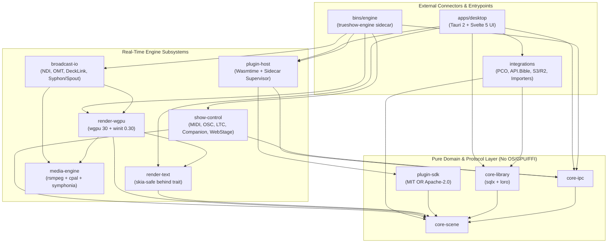
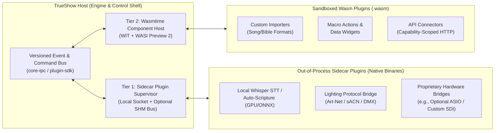

# Cargo Workspace, Plugin Architecture & License Audit — TrueShow

> **Status:** Accepted (Phase 1 Decisions Locked)  
> **Date:** November 2026  
> **Companion Doc:** [01-architecture-decision-record.md](./01-architecture-decision-record.md)

---

## 1. Repository Structure & Cargo Workspace Boundaries

The repository is organized as a single monorepo containing a strictly acyclic Cargo workspace (`crates/` + `bins/`), the Tauri 2 operator UI (`apps/desktop/`), WIT plugin contracts (`wit/`), and clean-room format/protocol fixtures (`tests/`).

```text
TrueShow/
├── Cargo.toml                  # Workspace root (shared dependency versions, lints, profiles)
├── deny.toml                   # cargo-deny license & supply-chain policy enforcement
├── LICENSE                     # MPL-2.0 (core application & workspace crates)
├── docs/
│   └── architecture/           # ADRs, workspace specs, roadmaps, protocol docs
├── wit/                        # WebAssembly Interface Types (MIT OR Apache-2.0)
│   └── trueshow-plugin.wit
├── crates/
│   ├── core-scene/             # Pure-Rust canonical scene graph, layers, looks, transitions
│   ├── core-library/           # SQLite (sqlx) + Loro CRDT store, FTS5 search, CCLI log
│   ├── core-ipc/               # Control-plane wire protocol + lock-free SHM preview ring
│   ├── render-text/            # Vector2DRasterizer trait + skia-safe CPU-cached backend
│   ├── render-wgpu/            # wgpu 30 + winit 0.30 multi-surface GPU compositor & shaders
│   ├── media-engine/           # rsmpeg (LGPL FFmpeg) HW decode + cpal/symphonia audio
│   ├── broadcast-io/           # NDI 6 (grafton-ndi), OMT, DeckLink FFI, Syphon/Spout2
│   ├── show-control/           # Timers, macros, MIDI, OSC, SMPTE LTC/MTC, Companion, WebStage
│   ├── integrations/           # PCO v2, MultiTracks, API.Bible, S3/R2 sync, format importers
│   ├── plugin-sdk/             # Public plugin types & IPC/WIT helpers (MIT OR Apache-2.0)
│   └── plugin-host/            # Sidecar process supervisor + Wasmtime Component Model host
├── bins/
│   └── engine/                 # Standalone `trueshow-engine` sidecar binary
└── apps/
    └── desktop/                # Tauri 2 shell (`src-tauri/`) + Svelte 5 TypeScript UI (`src/`)
```

### Crate Dependency DAG



### Crate Responsibilities & Architectural Invariants

| Crate | Primary Responsibility | Strict Architectural Invariants |
| :--- | :--- | :--- |
| **`core-scene`** | Resolution-independent scene graph: 7-layer stack, `Slide`, `Theme`, `Look`, `StageLayout`, `Transition`, `BlendMode`, `Mask`, `TimerState`, deterministic `SceneDiff`. | **Zero OS, GPU, or async I/O dependencies.** Compiles cleanly to `wasm32` if needed; 100% deterministic unit-tested. |
| **`core-library`** | Local-first SQLite (`sqlx`) storage, FTS5 song & Bible search, `loro` CRDT document/op persistence, BLAKE3 media manifest, CCLI live usage log. | All reads/writes succeed 100% offline. No network calls in this crate. |
| **`core-ipc`** | Framed binary `postcard` control messages (`EngineCommand`, `EngineEvent`, `EngineSnapshot`) over `interprocess` local sockets + lock-free triple-buffered shared memory ring for preview/editor pixel frames. | Explicit protocol versioning (`PROTOCOL_VERSION`) so mismatched UI/engine builds fail fast with a clear diagnostic. |
| **`render-text`** | `Vector2DRasterizer` trait for rich text paragraphs, strokes/outlines, drop shadows, rounded backdrops, chord-over-lyric alignment, RTL/CJK shaping, and editor caret hit-testing. Default backend: `skia-safe` CPU rasterizer. | Must **never** create a GPU context. Outputs premultiplied BGRA8 pixel slices + layout metrics for LRU GPU upload. |
| **`render-wgpu`** | `winit 0.30` physical display manager (EDID screen identity, borderless fullscreen, DPI), `wgpu 30` multi-surface compositor, 7-layer WGSL pipeline, YUV/YUVA shaders, per-Look rendering, GPU preview downsampler, and 3-slot async `MAP_READ` staging rings. | **Never blocks the render thread** on disk, network, or synchronous `device.poll(Wait)`. Enforces p99 frame time < 16.6 ms @ 60 fps. |
| **`media-engine`** | Dynamic LGPL FFmpeg (`rsmpeg`) demuxing/decoding, OS hardware decode -> `wgpu-hal` zero-copy import (`VideoToolbox`, `D3D12VA`/`D3D11VA`, `VA-API`), ProRes 4444 & VP9+alpha decode, dual-reader seamless loopers, and `cpal`/`symphonia` lock-free planar multi-channel audio mixer. | Real-time audio callbacks perform **zero heap allocations, zero syscalls, and zero mutex locks**. |
| **`broadcast-io`** | Feature-gated broadcast modules: `ndi` (`grafton-ndi` dynamic runtime loader), `omt` (`libomt`/`libvmx`), `decklink` (optional C++20 FFI for SDI Key & Fill), `virtual-out` (`syphon-wgpu` on macOS, `Spout2` D3D11On12 FFI on Windows). | **Zero proprietary SDK runtime DLLs/dylibs bundled in repo or installers.** Missing system runtimes degrade gracefully with clear UI status badges. |
| **`show-control`** | Concurrent countdown/count-up/elapsed timers, Macro execution engine, `midir` (CoreMIDI / Windows MIDI Services / ALSA), `rosc` (OSC), SMPTE LTC/MTC (`oximedia-timecode`), Bitfocus Companion Satellite + REST/WS server, and optional LAN browser Stage Display web server. | Runs on dedicated async/real-time threads decoupled from the GPU VSync thread; pushes atomic state updates into `render-wgpu`. |
| **`integrations`** | Planning Center Services v2 (OAuth2 PKCE), MultiTracks MIDI profile presets, API.Bible BYOK client (14/30-day cache TTL & FUMS), S3/R2 BLAKE3 asset sync (`object_store`), and clean-room importers (`.pro6`, `.pro` via `prost`, OpenLyrics, ChordPro, `.usr`, OSIS/Zefania/USFX/Beblia, `.pptx` OOXML + LibreOffice bridge, `.key` macOS AppleScript). | **Zero hardcoded API keys or copyrighted Bible texts.** All secrets live in OS Keychain (`keyring`). |
| **`plugin-sdk`** | Public, versioned types, capability manifests, and WIT/JSON-RPC contracts for third-party plugin authors. | Dual-licensed **`MIT OR Apache-2.0`** so plugin authors may freely choose permissive, copyleft, or commercial licenses. |
| **`plugin-host`** | Lifecycle manager, permission enforcement, and routing for Tier 1 Sidecar plugins and Tier 2 Wasmtime Component plugins. | Enforces crash isolation, memory/fuel limits, and capability whitelisting; a panicking plugin never drops live outputs. |
| **`bins/engine`** | Standalone `trueshow-engine` executable bundling `render-wgpu`, `media-engine`, `broadcast-io`, `show-control`, and `plugin-host` (engine-side plugins). | Can run either spawned by Tauri 2 or standalone as a headless/remote render daemon. |
| **`apps/desktop`** | Tauri 2 (`v2.12+`) Rust host + Svelte 5 TypeScript operator UI. | **Strictly control surface.** Never creates Audience/Stage live output windows via WebView. |

---

## 2. Two-Tier Plugin & Extension Architecture

Worship production environments have two radically different plugin profiles:
- **Lightweight Logic & Data Extensions:** Custom lyric/Bible importers, stage clock widgets, church management connectors, custom macro triggers, streaming title updaters.
- **Heavy Native / AI / Hardware Modules:** Local Whisper STT / real-time auto-scripture detection (GPU/ONNX/Python/C++), Art-Net / sACN lighting desks, PTZ camera tracking, or proprietary hardware video/audio drivers (DeckLink, ASIO, Dante).

No single plugin ABI serves both well. TrueShow therefore provides a **clean two-tier plugin boundary** and explicitly **rejects** in-process dynamic native libraries (`abi_stable` / raw `.dll`/`.so` `dlopen` for untrusted third-party plugins) because a single segfault or ABI mismatch in an in-process native plugin would crash live sanctuary projection.



### Tier 1: Out-of-Process Sidecar Plugins (Heavy Native / AI / Hardware)
- **Transport:** JSON-RPC 2.0 or framed binary (`postcard`) over local `interprocess` sockets (Named Pipes / Unix Domain Sockets), plus an optional read-only/write-only **shared-memory audio or video ring buffer** (e.g., tapping live pulpit audio PCM for a local Whisper STT sidecar without network/serialization overhead, or injecting an RGBA overlay texture).
- **Manifest (`plugin.toml`):** Declares plugin ID, semantic version, requested capabilities (`audio.tap`, `overlay.publish`, `cues.trigger`, `network.lan`), and per-OS binary entrypoints.
- **Benefits:**
  - **Zero crash blast radius:** If Whisper runs out of VRAM or a lighting daemon hangs, the supervisor restarts it without touching sanctuary screens.
  - **Polyglot:** Authors can write plugins in Rust, C++, Go, Swift, or Python.
  - **License Firewall:** Out-of-process communication over a documented IPC contract cleanly separates TrueShow's MPL-2.0 core from plugins carrying incompatible licenses (e.g., GPL-3.0 lighting libraries or proprietary hardware SDKs).

### Tier 2: Sandboxed WebAssembly Component Plugins (`wasmtime` + WIT)
- **Runtime:** `wasmtime` (`Apache-2.0 WITH LLVM-exception`) executing **WebAssembly Component Model** (`.wasm`) modules defined by `wit/trueshow-plugin.wit`.
- **Capabilities:** Strict capability-based security (WASI Preview 2) — plugins receive zero filesystem or network access unless explicitly granted by the user in Settings (e.g., scoped read access to an imported file, or allowlisted HTTP domains).
- **Real-Time Safety:** Executed asynchronously off the render thread with strict **epoch/fuel execution deadlines** and bounded linear memory so an infinite loop cannot starve the show.
- **Distribution:** Single cross-platform `.wasm` file works identically on Windows, macOS (Apple Silicon & Intel), and Linux without platform-specific compilation or Rust toolchain coupling.

---

## 3. Target License Architecture

### Recommendation: `MPL-2.0` Core + `MIT OR Apache-2.0` Plugin SDK

| Criterion | **MPL-2.0 (Recommended)** | **GPL-3.0 + Custom Linking Exception** |
| :--- | :--- | :--- |
| **Protects Open-Source Core?** | **Yes (file-level copyleft).** Any modification to TrueShow source files must be released under MPL-2.0, preventing closed-source forks of the engine. | **Yes (strong copyleft).** Covers the entire combined work unless explicitly exempted. |
| **Dynamic NDI / DeckLink / ASIO Compatibility** | **Clean & standard.** MPL-2.0 permits combining MPL files with separately licensed or proprietary dynamically loaded runtimes in a "Larger Work" without custom legal drafting. | **Legally fragile.** Requires a lawyer-reviewed custom linking exception (and every external contributor must grant the exact exception or sign a CLA). |
| **Dynamic LGPL-2.1+ FFmpeg Compatibility** | **Fully compatible** via LGPL dynamic linking provisions (Section 5/6) and LGPL-2.1-or-later upgrade path. | **Compatible**, though static mixing still triggers strict GPL distribution obligations. |
| **Third-Party Plugin Ecosystem** | **Frictionless.** Commercial, MIT, Apache-2.0, and GPL plugins can all target `plugin-sdk` (`MIT OR Apache-2.0`). | **Restrictive** for non-GPL in-process plugins unless covered by carefully scoped exception text. |
| **Rust Ecosystem Alignment** | **High.** Already used by key Rust media crates (e.g., `symphonia`); zero conflict with MIT/Apache-2.0 Rust crates. | **Moderate.** Requires auditing every transitive crate for GPLv2-only or license conflicts. |

### Clean-Room & CI Policy (`cargo-deny`)
1. Enforce a repository-root `deny.toml` in CI on every PR allowing only vetted licenses: `MIT`, `Apache-2.0`, `Apache-2.0 WITH LLVM-exception`, `BSD-2-Clause`, `BSD-3-Clause`, `ISC`, `Zlib`, `Unicode-3.0`, `MPL-2.0`, `BSL-1.0`, and explicitly audited `LGPL-2.1-or-later` dynamic bindings.
2. **Hard-block in CI:** `GPL-2.0`, `GPL-3.0`, `AGPL-3.0`, `SSPL-1.0`, and `WTFPL` (note: this specifically guides our choice of MIT-licensed `rsmpeg` over WTFPL-licensed `ffmpeg-next`/`ffmpeg-the-third`!).
3. **Clean-Room Rule:** Never copy source code, protobuf definitions with restrictive copyright headers, or assets from GPL-3.0 presentation apps (FreeShow, OpenLP, ChurchPresenter). All `.pro` wire-schema types must be independently authored from clean-room wire documentation / public schema specs with compatible licenses.

---

## 4. Complete Dependency & Licensing Compatibility Audit

> **Audit Baseline:** Core repository licensed under **MPL-2.0**; `crates/plugin-sdk` and `wit/` dual-licensed under **MIT OR Apache-2.0**.

### A. Core Framework, UI & Graphics

| Dependency | 2026 Track | License | Linking Model | MPL-2.0 Compat | Audit Notes & Flags |
| :--- | :--- | :--- | :--- | :--- | :--- |
| `tauri` (v2) / `tao` / `wry` | `2.12.x` | `MIT OR Apache-2.0` | Static Rust (OS WebView dynamic) | **Clean** | Uses OS WebView2 / WKWebView / WebKitGTK. |
| Svelte 5 + TypeScript + Vite | `5.x` | `MIT` | Frontend JS bundle | **Clean** | Zero copyleft frontend dependencies. |
| `wgpu` / `wgpu-hal` | `30.0.x` | `MIT OR Apache-2.0` | Static Rust | **Clean** | Targets Metal, D3D12, Vulkan natively. |
| `winit` | `0.30.x` | `Apache-2.0` | Static Rust | **Clean** | Runs exclusively inside `trueshow-engine` sidecar. |
| `skia-safe` + `skia-bindings` | Latest 2026 | `MIT` (crate) / `BSD-3-Clause` (Skia) | Static prebuilt C++ lib | **Clean (Verify Notice)** | Include Skia + HarfBuzz/ICU third-party license notices in About dialog; disable optional proprietary/non-free codecs in Skia feature flags. |
| *(Alt)* `vello` / `parley` / `skrifa` | Latest 2026 | `MIT OR Apache-2.0` | Static Rust | **Clean** | Pure-Rust fallback/future swap behind `render-text` trait. |

### B. Media Decode & Audio

| Dependency | 2026 Track | License | Linking Model | MPL-2.0 Compat | Audit Notes & Flags |
| :--- | :--- | :--- | :--- | :--- | :--- |
| `rsmpeg` + `rusty_ffmpeg` | Latest (FFmpeg 7/8) | `MIT` (crate) | Rust FFI -> **Dynamic FFmpeg** | **Clean** | Chosen over `ffmpeg-next` (stalled, WTFPL) and `ffmpeg-the-third` (WTFPL). |
| **FFmpeg shared libs** (`libavcodec`, `libavformat`, `libavutil`, `libswscale`, `libswresample`) | `7.1` / `8.x` | **`LGPL-2.1-or-later`** | **Dynamic ONLY** (`.dll`/`.dylib`/`.so`) | **Clean if Dynamic & LGPL-built** | **CRITICAL FLAG:** Must compile strictly with `--enable-shared` and **WITHOUT** `--enable-gpl` or `--enable-nonfree`. Never link `libx264`/`libx265`. Ship LGPL license text + build script/source offer so users can swap FFmpeg DLLs/dylibs. |
| `cpal` | `0.17.x` | `Apache-2.0` | Static Rust (OS CoreAudio/WASAPI/PipeWire) | **Clean** | **CRITICAL FLAG (ASIO):** Never enable the `asio` feature in default open-source release builds; Steinberg's ASIO SDK is proprietary and requires individual developer registration. Offer ASIO only as an opt-in build flag or external sidecar plugin. |
| `symphonia` | `0.5.x`+ | `MPL-2.0` | Static Rust | **Clean** | Same license as core! Pure-Rust audio decoding (WAV/FLAC/MP3/AAC/OGG). |
| `rtrb` / `rubato` | Latest | `MIT OR Apache-2.0` / `MIT` | Static Rust | **Clean** | Lock-free audio ring buffers & high-quality resampling. |

### C. Broadcast I/O & Virtual Outputs

| Dependency | 2026 Track | License | Linking Model | MPL-2.0 Compat | Audit Notes & Flags |
| :--- | :--- | :--- | :--- | :--- | :--- |
| `grafton-ndi` | NDI 6.x | `Apache-2.0` | **Dynamic runtime `dlopen`/`LoadLibrary`** | **Clean** | **CRITICAL HYGIENE:** Zero NDI SDK files or DLLs bundled. Loads user-installed NDI 6 Runtime via `NDI_RUNTIME_DIR_V6`. Display required NDI® trademark notice in UI when active. |
| `openmediatransport` (`libomt` / `libvmx` or Rust OMT crates) | Latest | `MIT` | Dynamic or Static C/Rust | **Clean** | Fully royalty-free LAN video/audio/alpha + mDNS discovery. Note: If using `libomtnet` (.NET NativeAOT build of `libomt`), verify binary size & Apple notarization vs. pure-Rust `openmediatransport`/`vmx-rs` wire compatibility in M2. |
| **Blackmagic DeckLink SDK Bridge** (`decklink-ffi`) | SDK 14.x+ | Proprietary EULA (headers allow include; drivers NOT redistributable) | **Optional Cargo Feature / Sidecar** + Runtime COM / CFPlugIn / `dlopen("libDeckLinkAPI.so")` | **Flagged — Isolate** | **CRITICAL FLAG:** Never bundle Blackmagic Desktop Video drivers. Because SDK headers carry a proprietary EULA, either keep `decklink-ffi` behind an opt-in `--features decklink` flag (fetched at build time) or ship it as a separately distributed official Tier 1 sidecar plugin so clean-room open-source builds compile cleanly without accepting Blackmagic's EULA. |
| `syphon-rs` / `syphon-wgpu` (macOS) | Latest | `MIT` (crate) / `BSD-3-Clause` (Syphon.framework) | Dynamic macOS Framework | **Clean** | True zero-copy `IOSurface` Metal sharing with `wgpu`. |
| `Spout2` (Windows) | `2.007+` | `BSD-2-Clause` | Static/Dynamic C++20 FFI shim | **Clean** | Bridge from `wgpu` D3D12 via `D3D11On12` / DXGI shared handles (`windows` crate, `MIT OR Apache-2.0`). |

### D. IPC, Show Control, Storage, Sync, Importers & Plugins

| Dependency | 2026 Track | License | Linking Model | MPL-2.0 Compat | Audit Notes & Flags |
| :--- | :--- | :--- | :--- | :--- | :--- |
| `interprocess` | `2.x` | `MIT OR Apache-2.0` | Static Rust | **Clean** | Cross-platform Named Pipes & Unix Domain Sockets. |
| `shared_memory` / `memmap2` | Latest | `MIT OR Apache-2.0` | Static Rust | **Clean** | Lock-free preview frame ring buffers. |
| `postcard` + `serde` | `1.x` | `MIT OR Apache-2.0` | Static Rust | **Clean** | Compact, fast binary IPC framing. |
| `sqlx` (SQLite bundled) | `0.9.x` | `MIT OR Apache-2.0` (SQLite: Public Domain) | Static Rust/C | **Clean** | Local-first relational & FTS5 database. |
| `loro` *(or `automerge`)* | `1.18.x` *(or `0.12.x`)* | `MIT` | Static Rust | **Clean** | Local-first CRDT state sync (Movable Tree + Fugue Text). |
| `object_store` + `blake3` | Latest | `Apache-2.0` / `CC0 OR Apache-2.0` | Static Rust | **Clean** | Pluggable S3 / Cloudflare R2 / MinIO asset sync. |
| `midir` | `0.11.x` | `MIT` | Static Rust | **Clean** | CoreMIDI, WinMM/WinRT (Windows MIDI Services), ALSA. |
| `rosc` | `0.11.x` | `MIT OR Apache-2.0` | Static Rust | **Clean** | OSC 1.0/1.1 show control. |
| `oximedia-timecode` / `vtc-rs` | Latest | `MIT OR Apache-2.0` | Static Rust | **Clean** | Pure-Rust SMPTE LTC / MTC decoding & generation. |
| `axum` / `tokio-tungstenite` | Latest | `MIT` | Static Rust | **Clean** | Bitfocus Companion API + LAN WebSocket Stage Display. |
| `prost` + `quick-xml` + `zip` | Latest | `Apache-2.0` / `MIT` | Static Rust | **Clean** | Clean-room `.pro`, `.pro6`, OpenLyrics, OSIS/Zefania/USFX, `.pptx` OOXML parsers. |
| `reqwest` + `oauth2` + `keyring` | Latest | `MIT OR Apache-2.0` | Static Rust | **Clean** | Planning Center PKCE OAuth2, API.Bible BYOK, OS Keychain storage. |
| `wasmtime` | Latest | `Apache-2.0 WITH LLVM-exception` | Static Rust | **Clean** | Tier 2 sandboxed WebAssembly Component plugin host. |
| **LibreOffice Headless** (optional) | System installed | `MPL-2.0` | **External OS Process** (`soffice --headless`) | **Clean** | Never bundled! Invoked only if installed on the user's machine and requested for high-fidelity `.pptx` visual import. |
| **Apple Keynote** (macOS optional) | System installed | Proprietary | **External OS Process** (AppleScript/JXA) | **Clean** | Invoked via macOS user automation only when importing `.key` files on macOS. |

### Summary of Flagged License & Supply-Chain Items (Action Required)
1. **FFmpeg Build Pipeline:** Must maintain a reproducible CI script compiling **strictly LGPL-2.1+ dynamic shared libraries** (no `--enable-gpl`, no `--enable-nonfree`, no `libx264`/`libx265`) and verify with `ffmpeg -buildconf` in CI.
2. **Blackmagic DeckLink SDK Headers:** Isolate behind an opt-in feature flag or separate official Tier 1 sidecar build so clean-room open-source builds have zero proprietary SDK header dependencies.
3. **Steinberg ASIO SDK:** Keep strictly disabled in default public builds (`cpal` uses WASAPI by default on Windows); expose only via opt-in build flag or external sidecar plugin.
4. **ProPresenter 7 `.pro` Schema Hygiene:** Verify the license of any community `.proto` schema referenced (e.g., MIT/Unlicense) or hand-author minimal clean-room `prost` message structs solely for the wire tags needed to extract song titles, slides, arrangements, and text runs.
