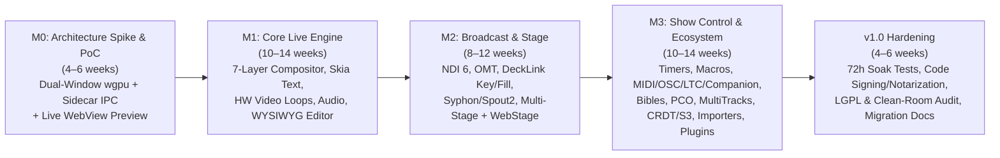

# Phased Engineering Roadmap — TrueShow

> **Status:** Accepted (Phase 1 Decisions Locked)  
> **Date:** November 2026  
> **Companion Docs:** [01-architecture-decision-record.md](./01-architecture-decision-record.md) | [02-workspace-and-plugin-design.md](./02-workspace-and-plugin-design.md)

---

## Milestone Flow & Critical Path

> **Estimate Basis:** Timelines assume a focused 1–2 engineer core team working full-time (or equivalent sustained OSS velocity) with early hardware testing on **both** Apple Silicon macOS (Metal) and Windows 11 NVIDIA/AMD/Intel GPUs (D3D12), plus Linux (Vulkan) CI verification.

---

## M0: Dual-Window GPU Compositor & Tauri Sidecar IPC Proof-of-Concept
**Target Duration:** 4–6 weeks  
**Primary Objective:** Prove the riskiest foundational boundaries *before* building product features: multi-monitor `winit` + `wgpu` 60 fps rendering inside a decoupled sidecar process, zero-blackout UI crash recovery, and low-latency native preview streaming into Tauri 2 + Svelte 5.

### Crates & Modules Initialized
- Workspace scaffold (`Cargo.toml`, `deny.toml` license CI gate, GitHub Actions matrix for Windows/macOS/Linux).
- `crates/core-scene` (minimal scene graph: solid colors, test patterns, crossfade transition, 2 logical outputs).
- `crates/core-ipc` (`interprocess` local socket control protocol + lock-free triple-buffered shared-memory preview ring).
- `crates/render-wgpu` (`winit 0.30` multi-monitor borderless fullscreen + `wgpu 30` multi-surface swapchain compositor + GPU preview downsampler + async `MAP_READ` staging ring).
- `bins/engine` (`trueshow-engine` standalone binary with heartbeat/reattach lifecycle).
- `apps/desktop` (Tauri 2 + Svelte 5 shell spawning `trueshow-engine` as `externalBin` sidecar, displaying live 30 fps Program preview via `tauri::ipc::Channel<Response>` -> WebGL2 `<canvas>`).

### Key Technical Spikes (De-Risking Gates)
1. **Monitor Identity & Hot-Plug:** Enumerate physical displays on Windows & macOS, persist display-to-output bindings across reboots (handling EDID / display index shifts when projectors sleep).
2. **macOS Spaces / Fullscreen Behavior:** Verify `winit` borderless fullscreen windows stay pinned above the menu bar/dock on secondary displays without stealing keyboard focus from the Tauri operator window.
3. **Preview Throughput:** Measure CPU/RAM overhead of streaming two `640×360` 30 fps preview buses from `trueshow-engine` -> SHM -> Tauri `Channel<Response>` -> WebGL2 `<canvas>`.

### Binary Exit Criteria (Must Pass Before M1)
- [ ] Two physical displays (or two native `wgpu` windows) sustain **locked 60 fps (p99 frame time < 16.6 ms)** with smooth animated GPU shaders on Windows (D3D12) and macOS (Metal).
- [ ] **Zero-Blackout Chaos Test:** Force-killing the Tauri 2 desktop process (`taskkill /F` / `kill -9`) leaves both physical `wgpu` output windows running uninterrupted at 60 fps; relaunching Tauri 2 automatically re-attaches and restores live preview within < 1 second.
- [ ] Live preview in Svelte 5 renders with **< 50 ms glass-to-glass latency** and **< 5% total CPU usage** on a mid-range laptop.
- [ ] `cargo deny check licenses` passes cleanly in CI across all three OS targets.

---

## M1: Core Lyric, Media, Layer Engine & Zero-Drift WYSIWYG Editor
**Target Duration:** 10–14 weeks  
**Primary Objective:** Deliver a Sunday-ready local presentation workflow covering multiple Audience displays, the full 7-layer GPU compositor, broadcast-grade typography, hardware-accelerated looping motion backgrounds, multi-channel audio, and pixel-identical slide editing.

### Crates & Modules Built
- `crates/core-scene` (expanded): Full 7-layer stack (`VideoInput`, `MediaBackground`, `Slide`, `Announcements`, `PropsAndOverlays`, `Masks`, `MessagesAndTimers`), per-screen **Looks**, blend modes, transitions (cut, dissolve, push, wipe), slide arrangements, themes.
- `crates/render-text`: `Vector2DRasterizer` trait + `skia-safe` CPU-rasterized backend (`SkParagraph` rich text, strokes/outlines, Gaussian drop shadows, gradients, rounded pill backdrops, auto-shrink fit, RTL/CJK shaping, caret/selection hit-testing) + LRU GPU texture cache.
- `crates/media-engine`:
  - Dynamic LGPL-2.1+ FFmpeg (`rsmpeg`) build scripts & loader.
  - Zero-copy GPU decode import: **VideoToolbox -> Metal** (`IOSurface`) on macOS, **D3D12VA / D3D11VA -> D3D12** on Windows, **VA-API -> Vulkan** on Linux (with automatic staging fallback).
  - Alpha video support: **ProRes 4444** (HW on Apple Silicon, SW->GPU YUVA shader on Windows/Linux) and **WebM VP9 + Alpha**.
  - Dual-reader pre-roll seamless looping engine for motion backgrounds.
  - Real-time audio engine (`cpal` + `symphonia` + lock-free planar multi-channel routing matrix).
- `crates/core-library`: SQLite (`sqlx` + WAL + FTS5) local library, playlists, song arrangements, media bin with BLAKE3 hashing, static thumbnail disk cache (`thumb://` custom protocol).
- `apps/desktop`: Complete operator workspace — Show view (virtualized slide grid, live Look selector, layer clear buttons, media bin, audio bin), Playlist manager, and **Zero-Drift Slide Editor** (engine-rendered WebGL2 canvas + SVG selection/snap gizmos + hidden IME `<textarea>` bridge).

### Key Technical Spikes (De-Risking Gates)
1. **Zero-Copy Video Decode Verification:** Validate zero-copy `IOSurface` (Metal) and `ID3D12Resource` (D3D12VA) decode of simultaneous dual 4K30 / triple 1080p60 H.264/HEVC motion backgrounds at < 15% CPU utilization.
2. **Loop Seam Frame Inspection:** Capture 10 consecutive loop wraparounds of a 1080p60 motion background and verify **zero dropped frames and zero black flashes** at the loop boundary.
3. **Complex Typography Verification:** Render a test matrix containing English + thick stroke + soft shadow, RTL Hebrew/Arabic, CJK, and superscript Scripture verse numbers; verify pixel-for-pixel match between Editor canvas and Audience display.

### Binary Exit Criteria (Must Pass Before M2)
- [ ] Drive **2+ independent Audience displays** with different aspect ratios (e.g., 16:9 main projection + 21:9/ultrawide LED wall) and independent **Looks** (e.g., full lyrics vs. lower-third lyrics) simultaneously at locked 60 fps.
- [ ] Play a looping 4K motion background + ProRes 4444 / WebM VP9 alpha overlay + animated lyric transition + multi-channel audio track simultaneously without audio xruns or frame drops.
- [ ] Slide Editor supports creating/editing multi-element slides (text, shapes, images, masks, transitions) with exact WYSIWYG parity against physical output.
- [ ] App runs 100% offline with zero network connections required.

---

## M2: Broadcast Video I/O (NDI, OMT, DeckLink Alpha), Virtual Outputs & Stage Displays
**Target Duration:** 8–12 weeks  
**Primary Objective:** Unlock full broadcast-studio workflows — transparent lower-third key/fill outputs over IP and SDI, live video inputs, zero-copy Syphon/Spout2 integration with OBS/vMix, and multi-layout native + browser Stage Displays.

### Crates & Modules Built
- `crates/broadcast-io`:
  - **NDI 6.x (`grafton-ndi`):** Dynamic runtime discovery & loading (zero bundled NDI DLLs), bidirectional send (straight/premul BGRA alpha) & receive (routable into `VideoInput` layer), group/source naming, tally feedback.
  - **Open Media Transport (OMT):** Native `libomt` / `libvmx` (or verified wire-compatible Rust OMT) bidirectional send & receive with alpha channel and mDNS zero-config discovery.
  - **Blackmagic DeckLink SDI (Optional Module / Sidecar):** C++20 FFI bridge targeting user-installed Desktop Video drivers; WGSL Fill + Luma-Key split pass feeding paired sub-devices (`IDeckLinkVideoOutput`) for ATEM/Ross external upstream keyers + single-port `IDeckLinkKeyer` internal keying.
  - **Virtual Outputs:** `syphon-wgpu` zero-copy Metal server/client on macOS; `Spout2` D3D11On12/DXGI shared-handle sender/receiver on Windows.
- `crates/render-wgpu` (expanded):
  - Dedicated **Stage Display Layout Engine** (Current Slide text/preview, Next Slide text/preview, ChordPro inline chords, Countdown/Elapsed/Clock widgets, Stage Message banner, live Video Input confidence preview).
  - Non-blocking 3-slot async `MAP_READ` staging readback workers dedicated to NDI/OMT/SDI outputs.
- `crates/show-control` (Stage subset):
  - Embedded `axum` + WebSocket server delivering an optional low-latency **LAN Browser Stage Display** (for confidence iPads/tablets on church Wi-Fi) consuming live scene/timer JSON updates + optional low-bitrate MJPEG/JPEG preview snapshots.

### Key Technical Spikes (De-Risking Gates)
1. **Alpha Integrity Verification:** Key a transparent TrueShow lower third over a live camera feed in **OBS (via NDI 6 & OMT & Syphon/Spout)** and on a **Blackmagic ATEM switcher (via DeckLink Duo 2 Key & Fill)**; verify clean anti-aliased edges with zero dark/white alpha fringing.
2. **Async Readback Isolation:** Enable 1× 1080p60 physical Audience display + 1× 1080p60 physical Stage display + 1× 1080p60 NDI Alpha send + 1× 1080p60 OMT send + 1× NDI live camera input concurrently; verify render thread frame times remain < 16.6 ms with zero stalls when network receivers disconnect or stall.

### Binary Exit Criteria (Must Pass Before M3)
- [ ] Bidirectional **NDI 6** (with alpha) and **OMT** (with alpha) interoperate cleanly with OBS Studio and vMix without bundling proprietary NDI runtime files.
- [ ] **Syphon** (macOS) and **Spout2** (Windows) deliver zero-copy VRAM frames to OBS Studio at 60 fps.
- [ ] **Blackmagic DeckLink** outputs synchronized Key & Fill SDI signals cleanly (tested on DeckLink Duo 2 / UltraStudio 4K Mini hardware or loopback capture).
- [ ] **Multiple independent Stage Displays** run natively via `wgpu` alongside concurrent LAN browser Stage clients.

---

## M3: Show Control, Worship Ecosystems, Local-First Sync, Importers & Plugin Host
**Target Duration:** 10–14 weeks  
**Primary Objective:** Complete automation, church-workflow integrations, multi-campus local-first cloud sync, library migration importers, and the extensibility boundary.

### Crates & Modules Built
- `crates/show-control` (complete):
  - **Timers Engine:** Unlimited concurrent Countdown, Countdown-to-Time, Count-Up, and Elapsed timers routable to Audience overlays, Props, and Stage Displays.
  - **Macros & Automations:** Multi-action reusable macros (switch Look, fire timer, clear specific layers, send MIDI/OSC, trigger slide/prop) bindable to slide cues, global hotkeys, and external triggers.
  - **Protocols:** Bidirectional **MIDI** (`midir` — MultiTracks Playback & Ableton Live cue profiles + outbound lighting/switcher cues), **OSC** (`rosc`), **SMPTE LTC & MTC** (`oximedia-timecode`), and **Bitfocus Companion** Satellite + REST/WS module API.
- `crates/integrations`:
  - **Bibles & Scripture:** Offline XML importers (`OSIS`, `Zefania`, `USFX`, `Beblia`) into SQLite FTS5 + **BYOK API.Bible** connector (OS Keychain storage, 14-day refresh / 30-day hard cache expiry, FUMS tracking, automatic attribution footer).
  - **Planning Center Services v2:** OAuth2 + PKCE desktop flow, batched service-plan/arrangement/team-note pull, header-aware rate limiting (`100 req / 20s`), offline plan caching.
  - **MultiTracks Open Path:** Pre-configured Playback / Ableton Live inbound MIDI cue mapping paired with Planning Center setlist sync (MultiTracks MCP excluded by design).
  - **CCLI & SongSelect Compliance:** Clean-room importers for ChordPro, SongSelect `.txt`, and `.usr`; automatic live Audience projection usage logger; one-click CSV/CCLI Reporting export.
  - **PowerPoint & Keynote Import:** Native Rust OOXML (`.pptx`) text/image slide importer + optional headless LibreOffice visual PDF/SVG raster importer; macOS AppleScript/JXA Keynote (`.key`) exporter bridge.
  - **Migration Importers:** Clean-room ProPresenter 6 (`.pro6` XML), ProPresenter 7 (`.pro` Protobuf via `prost`), OpenLyrics XML, ChordPro, and smart plain-text stanza importer.
- `crates/core-library` + `crates/integrations` (Sync):
  - **CRDT Metadata Sync (`loro`):** Multi-device sync of songs, playlists, themes, and shows over LAN peer-to-peer or optional sync relay, backed by SQLite WAL.
  - **Pluggable S3 Media Sync (`object_store`):** Background BLAKE3 content-addressed upload/download to user-configured Cloudflare R2, AWS S3, or MinIO buckets.
- `crates/plugin-sdk` + `crates/plugin-host`:
  - **Tier 1 Sidecar Supervisor** (local socket + optional audio/video SHM tap) with a reference example plugin (e.g., stub STT / lighting cue forwarder).
  - **Tier 2 Wasmtime Component Host** (`wit/trueshow-plugin.wit`) with a reference sample importer/widget `.wasm` plugin.

### Binary Exit Criteria (v1.0 Feature-Complete Gate)
- [ ] All 20 Target Capabilities verified against end-to-end automated & manual acceptance tests.
- [ ] Inbound MIDI cues from MultiTracks Playback / Ableton Live advance songs and slides with < 10 ms trigger-to-photon latency; Bitfocus Companion controls live layers and displays button feedback.
- [ ] Two offline machines edit the same service playlist independently, reconnect, and merge cleanly via `loro` CRDT while media assets sync automatically via Cloudflare R2 / MinIO.
- [ ] Real church libraries migrate cleanly from ProPresenter 6/7, OpenLyrics, ChordPro, and SongSelect `.usr` files.

---

## v1.0 Public Release Hardening (4–6 Weeks Post-M3)
- **72-Hour Continuous Soak Tests:** Run looping 4K backgrounds, periodic slide transitions, live NDI/OMT output, and active timers for 72 hours continuously on Windows 11 and macOS Apple Silicon; assert zero VRAM/RAM leaks (< 1% growth over 72h) and zero dropped frames.
- **Release Packaging & Signing:** Apple Developer ID signing & notarization (handling hardened runtime entitlements for dynamic NDI/DeckLink/FFmpeg library loading), Windows Authenticode signing (MSI/NSIS), Linux AppImage/Flatpak.
- **Compliance & Clean-Room Audit:** Final `cargo-deny` audit, LGPL FFmpeg dynamic-link compliance bundle verification, API.Bible 30-day cache expiry test, and third-party attribution dialog verification.

---

## 20-Capability Traceability Matrix

| # | Target Capability | Primary Milestone | Owning Crate(s) |
| :-: | :--- | :---: | :--- |
| 1 | Multiple Audience Displays (independent res/aspect/looks) | M0 -> M1 | `render-wgpu`, `core-scene` |
| 2 | Multiple Stage Displays (+ LAN WebSocket browser view) | M2 | `render-wgpu`, `show-control` |
| 3 | Graphics Hardware Acceleration (zero-copy 60 fps 1080p/4K) | M0 -> M1 | `render-wgpu`, `media-engine` |
| 4 | Compositing Multiple Presentation Layers (7 layers + blends) | M1 | `core-scene`, `render-wgpu` |
| 5 | Virtual Outputs (Syphon macOS, Spout2 Windows) | M2 | `broadcast-io`, `render-wgpu` |
| 6 | Transparent Slide Backgrounds (Alpha Key/Fill NDI/OMT/SDI) | M2 | `render-wgpu`, `broadcast-io` |
| 7 | Motion Backgrounds & Audio/Video (ProRes 4444, VP9+alpha, HW H.264/HEVC) | M1 | `media-engine`, `render-wgpu` |
| 8 | NDI 6.x Bidirectional (Dynamic) + Native OMT I/O | M2 | `broadcast-io` |
| 9 | Timers (concurrent countdown, count-up, elapsed) | M3 *(basic clock in M2 Stage)* | `show-control`, `core-scene` |
| 10 | Macros / Automations (slides, hotkeys, external cues) | M3 | `show-control`, `core-scene` |
| 11 | MIDI, OSC, SMPTE LTC/MTC, Bitfocus Companion API | M3 | `show-control` |
| 12 | Bibles / Scripture (Offline OSIS/Zefania/USFX/Beblia + BYOK API.Bible) | M3 | `integrations`, `core-library` |
| 13 | Planning Center Services v2 (OAuth2 PKCE) | M3 | `integrations` |
| 14 | MultiTracks Open Path (Playback MIDI Cues + PCO Sync) | M3 | `show-control`, `integrations` |
| 15 | CCLI & SongSelect Strategy (ChordPro/`.usr` + usage log + CSV export) | M3 | `integrations`, `core-library` |
| 16 | PowerPoint (`.pptx` OOXML / LibreOffice) & Keynote (`.key` AppleScript) | M3 | `integrations` |
| 17 | Cloud Sync (Local-first SQLite + `loro` CRDT + S3/R2 `object_store`) | M3 | `core-library`, `integrations` |
| 18 | Cross-Platform Parity (First-class Windows & macOS, Linux bonus) | M0–M3 | All workspace crates |
| 19 | Migration Importers (Clean-room Pro6/Pro7, ChordPro, OpenLyrics, Text) | M3 | `integrations` |
| 20 | Plugin / Extension Architecture (Tier 1 Sidecar + Tier 2 Wasmtime WIT) | M3 *(SDK traits locked in M1)* | `plugin-sdk`, `plugin-host` |
